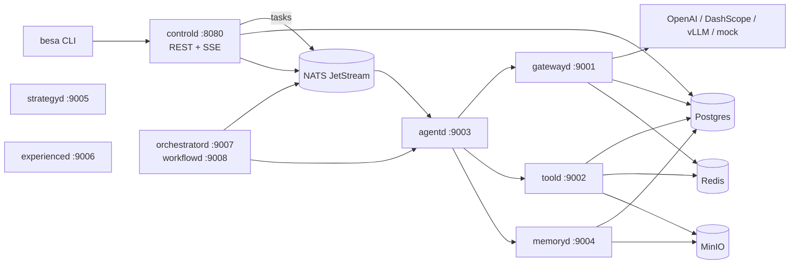

# BesaAgent（Go 分布式版）

面向**软件测试全流程**的多智能体平台：需求 → 测试设计 → 用例 → 环境 → 执行 → 分析 → 缺陷。

本仓库是 `besa-agent`（Python）的 Go 重构与**分布式化**实现。设计文档来自原项目的 `docs/`，
分层、契约与失败语义被保留；进程边界、持久化、事件与调度被重做为一组可独立部署的服务。

> 默认配置**全部指向 mock**：不需要密钥、数据库或网络即可跑通。接真实厂商只改配置。

---

## 1. 快速开始（单机，无外部依赖）

需要 Go 1.26+。

```bash
# 装配检查：每个模型可用吗、逻辑名走哪条链、工具/策略是否就绪
go run ./cmd/besa --env test doctor

# 跑一条任务
go run ./cmd/besa --env test run "帮我为登录接口设计测试用例"

# 多轮对话
go run ./cmd/besa --env test chat

# 单进程起全部服务（REST + 8 个 gRPC 服务）
go run ./cmd/besa --env test serve --role all
curl http://127.0.0.1:8080/healthz
```

`--env test` 会禁用 Postgres / Redis / NATS，所有状态落在进程内，仅用于本地与 CI。

接真实模型：

```bash
cp .env.example .env
# 写入 DEEPSEEK_API_KEY 等，然后把 configs/dev.yaml 的候选链指到真实模型
go run ./cmd/besa --env dev run "..." --stage test_case
```

## 2. 分布式部署

```bash
docker compose up --build -d
curl http://127.0.0.1:8080/healthz
```

Compose 会启动 Postgres(pgvector)、Redis、NATS JetStream、MinIO 与 8 个 BesaAgent 服务。



### 服务职责

| 服务 | 角色 | 职责 | 关键状态 |
|---|---|---|---|
| `controld` | 控制面 | REST 提交/查询任务、SSE 事件、取消、outbox relay | `tasks`、`sessions`、`messages`、`events` |
| `gatewayd` | 模型网关 | alias → 候选链、重试/降级/熔断/限流/计价 | 进程内熔断 + Redis 限流 + Postgres 用量 |
| `toold` | 工具执行 | schema/注入/权限/幂等/沙箱/脱敏/落盘 | `tool_executions`、Redis 快路径、MinIO |
| `agentd` | 单 agent 运行时 | 路由、预算、续跑判定、运行内压缩、收尾 | `checkpoints`、`runs`、`run_steps` |
| `memoryd` | 长期记忆 | 三道闸门、查重/强化/合并/更新、衰减、检索 | `memory`、`memory_op_log`、pgvector |
| `strategyd` | 组件策略 | 注册/契约校验/模板/规则/评测选择 | `strategy_eval` |
| `experienced` | 经验闭环 | 失败分类、定向恢复、经验沉淀/检索/降级 | `experiences`、`experience_applications` |
| `orchestratord` | 多 agent / DAG | 并行/委员会/辩论/层级；DAG 校验与调度 | `workflow_runs`、`workflow_nodes`、`checkpoints` |

单二进制通过 `--role` 切换；**每个服务也可以独立扩缩容**。NATS durable consumer 让
`agentd` / `workflow` worker 天然支持多副本竞争消费。

## 3. REST API

```bash
# 异步提交
curl -X POST http://127.0.0.1:8080/v1/tasks \
  -H 'Content-Type: application/json' \
  -d '{"goal":"帮我为登录接口设计测试用例","session_id":"s1","caller":"demo","stage":"test_case"}'

# 查询
curl http://127.0.0.1:8080/v1/tasks/<task_id>
curl 'http://127.0.0.1:8080/v1/tasks?session_id=s1'

# 同步运行（走 agent 服务）
curl -X POST http://127.0.0.1:8080/v1/agent/run \
  -H 'Content-Type: application/json' \
  -d '{"task":"...","stage":"test_case","session_id":"s1"}'

# 事件流（SSE）
curl -N 'http://127.0.0.1:8080/v1/events/stream?session_id=s1'

# 取消
curl -X POST http://127.0.0.1:8080/v1/runs/<run_id>/cancel

# 策略 / 工作流 / 编排
curl -X POST http://127.0.0.1:8080/v1/strategy/select -d '{"task_type":"用例生成","risk":"low"}'
# 工作流：REST 接收 JSON；YAML 文件请用 `besa workflow validate|run <file>`
curl -X POST http://127.0.0.1:8080/v1/workflow/validate -H 'Content-Type: application/json' -d @workflow.json
curl -X POST http://127.0.0.1:8080/v1/orchestrate -d '{"task":"...","strategy":"committee","participants":["requirement","test_case","analysis"]}'
```

## 4. CLI

```bash
besa doctor
besa run "..." --stage test_case --session s1 [--resume --run-id <id>]
besa chat
besa strategy list
besa strategy select --task-type 用例生成 --risk low --assets has_test_cases
besa workflow validate configs/workflows/full-test-flow.yaml
besa workflow run configs/workflows/full-test-flow.yaml --input '{"task":"..."}'
besa migrate
besa serve --role all|control|gateway|tool|agent|memory|strategy|experience|orchestrator|workflow
```

退出码：`0` 成功；`1` 失败；`2` 配置/用法错误；`3` 需要人工复核（`needs_review`）。

## 5. 代码结构

```
cmd/besa/                单二进制入口
api/proto/v1/            gRPC 契约（生成代码与 proto 同目录）
internal/
  foundation/            配置、日志、时钟、ID、错误（不依赖业务模块）
  domain/                与厂商无关的消息/用量/成本/结果
  provider/              厂商适配：openai / dashscope / vllm / mock
  gateway/               选链、重试、降级、熔断、限流、计价、账本
  agent/                 阶段注册、路由、执行循环、运行时（预算/续跑/压缩）
  context/               预算、切分（turn/step）、L1/L2/L3 压缩、组装
  tool/                  工具契约、权限、注入、幂等、结果处置 + builtin
  memory/                提取、闸门、冲突判定、检索、衰减
  strategy/              组件策略注册表、契约、模板、选择器、评测
  workflow/              Agent Pool、DAG、校验、调度、检查点
  multiagent/            并行/委员会/辩论/层级编排 + 工作流适配
  experience/            失败分类、恢复、经验对象、门控、检索
  event/                 事件形状、进程内总线、NATS JetStream、持久化 outbox
  store/                 postgres / redis / memstore / S3
  transport/             protobuf 转换、gRPC 客户端与服务端辅助
  service/*d/            各角色的 gRPC 服务实现
  composition/           组合根：配置 → 注册表 → 网关 → 工具 → …（唯一装配点）
  app/                   CLI 与守护进程编排
configs/                 base / dev / test / prod + workflows
migrations/              内嵌 SQL（唯一 DDL 来源）
docs/                    架构与迁移映射
```

## 6. 被保留的关键纪律

这些不是风格偏好，是原项目用 bug 换来的约束：

1. **重试不叠加**：provider 只重试网络层；HTTP 4xx/5xx/429 一律交给 gateway 做跨模型决策。
   `CallBudget` 是唯一的上游调用计数点。
2. **`nil` ≠ 0**：token 与成本「未知」用 `nil`/空字符串表示；`0` 是免费。报表不会静默失真。
3. **能力是模型的事实**：`capability` 过滤在选链阶段完成；不可用模型不进入链、也不计入 `degraded`。
4. **不可用 ≠ 降级**：缺密钥只让模型不可用（启动期告警），不会让进程起不来。
5. **幂等权威在 Postgres**：Redis 只是快路径；清空 Redis 只会变慢，不会让去重失效。
6. **工具顺序**：找工具 → 参数 → 注入 → 权限 → 循环 → 无效重试 → 幂等登记 → 执行 → 收尾。
   **权限先于幂等**，否则去重表会变成越权读取通道。
7. **`uncertain` 只在读取时判定**：超租约的 `in_flight` 不会被写回成确定状态；
   续跑遇到它默认 `needs_review`，不替人做“重做/放弃”的取舍。
8. **运行内压缩按“步”切**：一次运行的消息全在同一“轮”，按轮切一步都压不掉；
   工具调用与结果属于同一步，不会被切开。
9. **预算三层传导**：整轮 deadline / 单次调用上限取 min；步数、工具次数、成本都有上界，
   撞上哪一个必须写进错误信息。
10. **收尾是旁路**：快照、事件、记忆沉淀任何一件失败都不得让运行失败，但都必须可见。
11. **高风险策略只在“合法 ∩ 已验证”组合里选**；空集直接拒绝，不降级。
12. **失败归因不把假设当结论**：`needs_review` 不算失败；Critic 只能产生假设，
    升格为 `verified` 必须经过证据校验。

## 7. 测试

```bash
go test ./...
go vet ./...
```

当前覆盖：网关重试/降级/熔断/成本语义；工具幂等/权限/注入/租约；agent 路由/循环/续跑；
上下文预算/按步压缩/去重/组装；工作流校验/调度/重试/失败传播；策略模板/高风险拒绝/契约；
记忆闸门/衰减/检索；经验门控/恢复/降级。

## 8. 文档

- [docs/architecture.md](docs/architecture.md) —— 分布式架构、数据流、一致性、失败语义
- [docs/migration-mapping.md](docs/migration-mapping.md) —— Python 模块 → Go 包映射与差异
- [docs/innovations.md](docs/innovations.md) —— 三个创新点在代码中的落点
- [configs/README.md](configs/README.md) —— 配置组 ↔ 能力 ↔ 实现
- 原始设计文档在兄弟仓库 `../besa-agent/docs/`
