# BesaAgent（Go 分布式版）— 项目级代码仓库深度分析报告

## 分析概览

| 项 | 值 |
|---|---|
| 分析时间 | 2026-10-28 |
| 分析目标 | `E:\aloha\AIComponents\besa-agent-go` |
| 目标类型 | project（整个项目） |
| 仓库版本 | `005cb9f`（`main`，已推送 `origin/main`） |
| 分析维度 | 全局盘点 / 目录扫描 / 入口定位 / 主链路 / 数据流 / 状态管理 / 依赖图 / 配置 / 核心机制 / 错误处理 / 测试 / 性能并发 / 扩展点 / 抽象架构 / 面试讲解 |
| 分析方法 | 目录与文件盘点、`go.mod`、源码导入关系扫描（排除测试文件）、关键函数逐行阅读、测试清单、配置与迁移 SQL 对照 |
| 规模 | 127 个手写 `.go` 文件，20,879 行（生产约 19.7k，测试约 1.1k）；另有 `besa.proto` 528 行与生成代码 6,941 行 |
| 限制 | 未启动 Docker/Postgres/NATS/Redis 全栈；未在目标数据库执行迁移；未调用真实模型厂商；未测得覆盖率与压测数据（详见“待确认项”） |

> 结论边界：本文只基于仓库内真实代码、配置、文档与 Git 记录。凡未实际运行验证的内容，均在“待确认项”中标注，不把“编译通过”等同于“运行正确”。

---

## 1. 全局盘点

### 项目定位

BesaAgent 是面向**软件测试全流程**的多智能体平台：需求 → 测试设计 → 用例 → 环境 → 执行 → 分析 → 缺陷。Go 版把原先 Python 单进程运行时拆成控制面 + 8 个可独立部署的角色，同时保留原设计中的分层、契约和失败语义。

它解决的问题不是“生成一段测试用例文本”，而是：

- 把不同测试阶段做成**数据驱动的阶段 Agent**；
- 把模型调用收敛到**统一网关**（选链、重试、降级、熔断、限流、计价）；
- 把工具执行做成**有权限、幂等、可审计**的副作用边界；
- 让长任务“跑到一半被打断”成为可判定状态（检查点 + `needs_review`）；
- 用 DAG 编排多个 Agent，并用失败经验闭环反哺后续任务。

### 项目类型

**混合型**：

- CLI（`besa run/chat/doctor/strategy/workflow/migrate`）
- 控制面 REST + SSE（`controld`）
- gRPC 微服务（gateway/tool/agent/memory/strategy/experience/orchestrator/workflow）
- 可复用领域库（provider/gateway/agent/context/tool/…）
- Agent 运行时与任务编排平台

### 技术栈

| 类别 | 选型 | 证据 |
|---|---|---|
| 语言 | Go 1.26 | `go.mod:3` |
| 同步 RPC | gRPC + protobuf | `api/proto/v1/besa.proto`，`internal/transport/grpc.go` |
| 异步总线 | NATS JetStream | `internal/event/nats.go` |
| 权威存储 | PostgreSQL + pgvector | `migrations/0001_init.sql`，`internal/store/postgres` |
| 快路径/限流 | Redis（Lua） | `internal/store/redis/redis.go` |
| 对象存储 | MinIO / S3 | `internal/store/artifact/s3.go` |
| HTTP | chi | `internal/service/controld/server.go` |
| 校验/数值 | jsonschema、shopspring/decimal | `internal/tool/executor.go`，`internal/gateway/cost.go` |
| 配置 | YAML + 环境变量插值 | `internal/foundation/config` |

### 关键入口

- **主入口**：`cmd/besa/main.go:12` → `app.NewCLI().Run(...)`
- **命令分发**：`internal/app/app.go:38`
- **服务角色分发**：`internal/app/serve.go:62`
- **控制面 HTTP**：`internal/service/controld/server.go:122`（提交）、`:287`（SSE）
- **gRPC 服务注册**：`internal/app/serve.go:103`（all 模式）、`:243`（agent 角色）等
- **测试入口**：`go test ./...`，9 个 `*_test.go`

### 关键文档

| 文档 | 作用 |
|---|---|
| `README.md` | 快速开始、服务表、纪律清单、API 示例 |
| `docs/architecture.md` | 分布式架构、数据流、一致性、失败语义 |
| `docs/migration-mapping.md` | Python 模块 → Go 包映射与差异 |
| `docs/innovations.md` | 三个创新点在代码中的落点 |
| `configs/README.md` | 配置组 ↔ 能力 ↔ 实现 |
| `deploy/README.md` / `deploy/k8s/besa.yaml` | 容器与 K8s 部署 |

### 一句话总结

> 一个以 Go 重写的测试领域多 Agent 平台：用 gRPC 拆开模型网关、工具执行、Agent 运行时与编排，
> 用 NATS 承载作业与事件，用 Postgres/Redis/S3 分别承载权威状态、快路径与产物；
> 默认 mock 可无依赖跑通，核心价值在“可判定、可恢复、可审计”的执行语义。

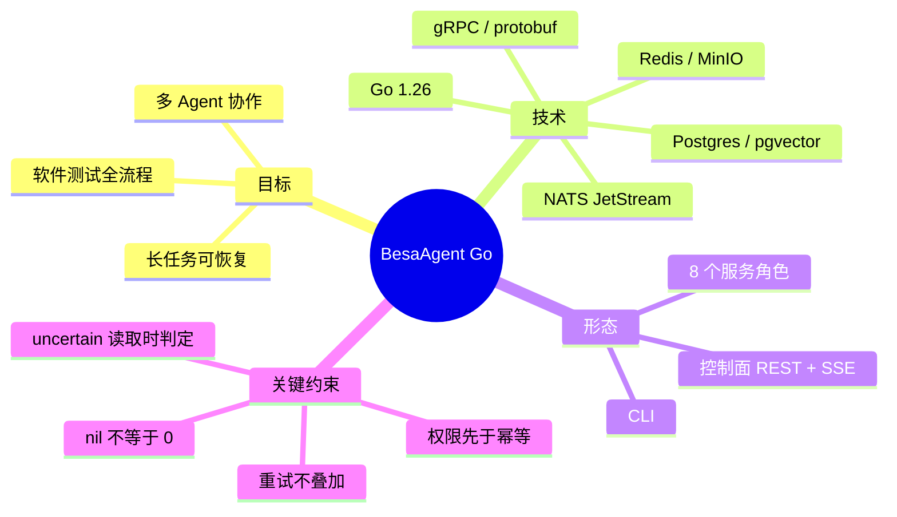

---

## 2. 目录扫描

### 模块清单

#### 核心模块（业务语义）

| 模块 | 职责 | 边界 | 输入 | 输出 |
|---|---|---|---|---|
| `internal/provider` | 厂商协议适配（OpenAI 兼容、mock） | 只关心“请求怎么写/响应怎么读”，不选模型、不重试 HTTP | `domain.ChatRequest` | `domain.ChatResponse` / `EmbeddingResult` |
| `internal/gateway` | 逻辑名选链、熔断、限流、重试、降级、计价、账本 | 模型调用唯一入口；provider 唯一消费者 | alias + messages | `domain.GatewayResult` |
| `internal/agent` | 七阶段注册、路由、执行循环、预算、续跑、运行内压缩 | 不 import provider / multiagent；记忆只经 context | `RunRequest` | `RunOutcome` |
| `internal/context` | 预算、按轮/按步切分、L1–L3 压缩、去重、组装 | 不直接调 memory 的三道闸门 | 历史 + 当前输入 | `Built.Messages` / `CompactResult` |
| `internal/tool` | 工具契约、schema、注入、权限、幂等、租约、脱敏、落盘 | 工具业务异常不冒泡；副作用边界 | `Invocation` | `Result` |
| `internal/memory` | 提取、三道闸门、查重/强化/合并/更新、衰减、检索 | 只经 context 接缝被使用 | 对话轮次 / query | `Item` / `Scored` |
| `internal/strategy` | 组件策略注册、契约、模板、规则/评测选择 | 只产出 `AgentProfile`，不构造组件 | `TaskFeatures` | `SelectionDecision` |
| `internal/workflow` | Agent Pool、DAG、校验、调度、图级检查点 | fail-closed；不 import multiagent | `Workflow` + input | `RunReport` |
| `internal/multiagent` | 并行/委员会/辩论/层级编排 | 只把 `run_one` 当零件 | 任务 + 参与者 | `Outcome` |
| `internal/experience` | 失败分类、恢复决策、经验门控/检索/降级 | 未验证假设默认不入库 | `Failure` / `Hypothesis` | `RecoveryDecision` / `Experience` |

#### 辅助模块

| 模块 | 职责 | 边界 | 输入 | 输出 |
|---|---|---|---|---|
| `internal/domain` | 跨模块的厂商无关类型 | 不依赖任何业务包 | — | Message/Usage/Cost/Result |
| `internal/event` | 统一事件形状、内存总线、NATS、持久化 outbox | 事件失败不影响主流程 | `Event` | 发布/订阅 |
| `internal/transport` | protobuf 转换、gRPC 客户端/服务端辅助 | 领域 ↔ DTO 的唯一转换点 | 领域对象 | DTO / RPC |
| `internal/composition` | 组合根：配置 → 注册表 → 网关 → 工具 → … | 唯一 import 全部业务模块的地方 | `Config` | `Base` / `LocalRuntime` |
| `internal/app` | CLI、角色启动、NATS worker | 入口编排，不含业务算法 | 参数 | 进程/命令结果 |
| `internal/service/*d` | 各角色的 gRPC/HTTP 适配 | 薄层，只做协议转换与调用 | proto/HTTP | proto/HTTP |

#### 基础设施模块

| 模块 | 职责 | 边界 | 输入 | 输出 |
|---|---|---|---|---|
| `internal/foundation` | 配置、日志、时钟、ID、错误、脱敏 | 不依赖业务模块 | 文件/环境 | 基础能力 |
| `internal/store/postgres` | 22 张表的仓储实现 | 权威状态 | SQL/领域对象 | 行/视图 |
| `internal/store/redis` | 幂等快路径、分布式限流、取消键、锁 | 不是权威 | key/value | claim/decision |
| `internal/store/memstore` | 单机/测试用内存实现 | 进程内，非生产 | 内存对象 | 同接口 |
| `internal/store/artifact` | S3/MinIO 对象存储 | 只存大结果/产物 | bytes | `s3://` URI |
| `configs/` | 环境配置与工作流模板 | 无密钥本体 | YAML/环境 | `Config` |
| `migrations/` | 内嵌 SQL（唯一 DDL 来源） | 迁移独占 | — | 表结构 |
| `deploy/` | Compose/K8s 清单 | 部署资产 | — | 运行环境 |

### 依赖关系

- 核心链路：`provider ← gateway ← agent ← {workflow, multiagent}`，`agent` 同时依赖 `context` 与 `tool`。
- `memory` 依赖 `context` 的 `Turn` 类型；`context` 只依赖 `MemoryProvider` 接口，不依赖 `memory`。
- `store/postgres` 实现 `agent` / `tool` / `memory` / `strategy` / `experience` / `workflow` 定义的接口，因此反向依赖这些领域包（适配器方向）。
- `transport` 同时依赖几乎所有领域包，作为“协议转换层”的代价。
- `composition` 依赖全部模块，是唯一的装配点；`app` 依赖 `composition` 与各 `service/*d`。
- 没有发现导入环（脚本扫描 127 个非测试文件）。

### 目录与功能映射

| 目录路径 | 功能模块 | 是否一致 | 差异说明 |
|---|---|---|---|
| `internal/provider` | 厂商适配 | ✅ | 适配器子包极薄，共用 `compat.go` |
| `internal/gateway` | 模型网关 | ✅ | 12 文件 2,191 行，是最大单模块 |
| `internal/agent` | 单 Agent 运行时 | ✅ | `agent/stages/` 为空目录，阶段提示词实际在 `prompts.go` |
| `internal/context` | 上下文管理 | ✅ | — |
| `internal/tool` | 工具层 | ✅ | `builtin/` 为 read/grep/write/bash |
| `internal/workflow` | DAG 编排 | ✅ | 设计文档中的 `src/workflow` 落地 |
| `internal/multiagent` | 多 Agent 编排 | ✅ | 单文件 364 行 |
| `internal/memory` | 长期记忆 | ✅ | 向量检索实现放在 `store/postgres` |
| `internal/strategy` | 组件策略 | ✅ | 只选择，不实现策略 |
| `internal/experience` | 经验闭环 | ✅ | — |
| `internal/store/postgres` | 持久化 | ✅ | 同时承载记忆/经验/工作流仓储 |
| `internal/service/*d` | 进程边界 | ✅ | 每个角色一个薄服务 |
| `internal/foundation/telemetry` | 遥测 | ⚠️ | **空目录，未实现** |
| `internal/agent/stages` | 阶段包 | ⚠️ | **空目录，提示词实际在 `internal/agent/prompts.go`** |
| `api/proto/v1` | 契约 + 生成代码 | ⚠️ | Go 生成文件与 `.proto` 同目录，未单独放 `gen/` |

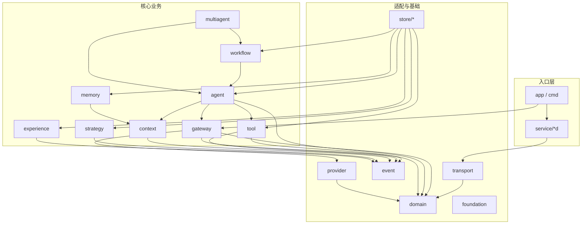

---

## 3. 入口定位

### 启动入口

#### 主入口

- 文件位置：`cmd/besa/main.go:12`
- 入口函数：`main()`
- 触发方式：`besa <command> [flags]`；用 `signal.NotifyContext` 接收 `SIGINT/SIGTERM`

```go
ctx, stop := signal.NotifyContext(context.Background(), os.Interrupt, syscall.SIGTERM)
os.Exit(app.NewCLI().Run(ctx, os.Args[1:]))
```

#### 其他入口

| 入口类型 | 文件位置 | 入口函数 | 触发方式 |
|---|---|---|---|
| CLI | `internal/app/app.go:38` | `CLI.Run` | 子命令分发 |
| 单机任务 | `internal/app/app.go:130` | `cmdRun` | `besa run` |
| 交互对话 | `internal/app/app.go:192` | `cmdChat` | `besa chat` |
| 服务角色 | `internal/app/serve.go:43/62` | `cmdServe/runServe` | `besa serve --role` |
| 控制面 HTTP | `internal/service/controld/server.go:63` | `Handler()` | `/v1/*` |
| gRPC 服务 | `internal/transport/grpc.go:77` | `Serve` | 各角色端口 |
| NATS worker | `internal/app/worker.go:32/123` | `StartAgent/StartWorkflow` | durable consumer |
| 测试 | `internal/*/*_test.go` | `go test` | 9 个测试文件 |

### 参数解析

1. **全局参数前置处理**：`splitGlobals`（`internal/app/app.go:94`）允许 `--env/--config` 出现在命令前后，并写入 `CLI.globalEnv/globalConfig`。
2. **子命令参数**：每个子命令用 `flag.NewFlagSet`，例如 `run` 的 `--stage/--session/--resume/--run-id`。
3. **服务角色**：`serve --role all|control|gateway|tool|agent|memory|strategy|experience|orchestrator|workflow`，`--addr` 可覆盖配置。
4. **配置文件**：`config.Load`（`internal/foundation/config/config.go:37`）按 `base.yaml → <env>.yaml` 深度合并，再对 `${VAR}` / `${VAR:-default}` 插值。
5. **环境变量覆盖**：`BESA_POSTGRES_DSN / BESA_REDIS_URL / BESA_LOG_LEVEL` 在加载后强制覆盖（`config.go:338-340`）；`BESA_ENV` / `BESA_CONFIG_DIR` 决定环境与目录。

### 初始化流程（单机 / all 模式）

1. `CLI.Run` 解析子命令。
2. `composition.BuildLocal`（`internal/composition/local.go:40`）→ `composition.Open`（`base.go:52`）。
3. `config.Load` 读取配置；`logx.New` 初始化结构化日志（默认文本，生产 JSON）。
4. 按需打开 Postgres（自动迁移）、Redis、NATS；任一非必需依赖失败只告警降级。
5. 构建事件出口：有 DB → `Persistent + InMemory`；无 DB 但有 NATS → `NATS + InMemory`；否则 `InMemory`。
6. `BuildGateway` → `BuildTools` → `BuildMemory` → `BuildContext` → `BuildAgent` → `BuildStrategy` → `BuildExperience` → `BuildWorkflow` → `NewOrchestrator`。
7. `runAll` 启动 8 个 gRPC server、控制面 HTTP、usage flusher、outbox relay。
8. 阻塞在 `ctx.Done()`；退出时先 flush 用量/事件，再关闭连接。

### 初始化与运行边界

- **初始化完成标志**：`BuildLocal`/角色 builder 返回，gRPC `Serve` 开始监听，控制面 `ListenAndServe` 启动。
- **运行阶段开始标志**：NATS durable consumer 开始 `iter.Next()`；HTTP 开始处理请求；CLI 进入 `RunOne` 或 `chat` 循环。

### 关键调用链（启动）

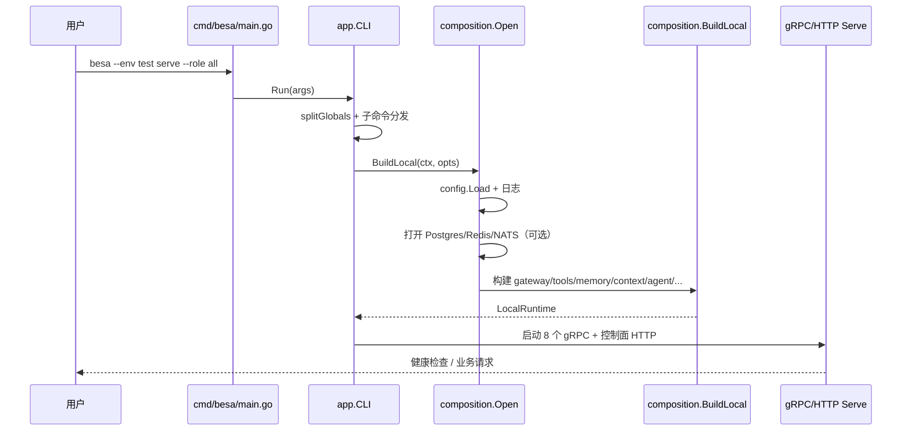

---

## 4. 主链路分析

### 4.1 链路 A：HTTP 异步任务（分布式主链路）

**完成什么**：客户端提交一个测试任务，执行 Agent 循环，持久化会话与检查点，更新任务状态，并通过 SSE 推送事件。

| 节点 | 位置 | 输入 | 输出 | 处理逻辑 |
|---|---|---|---|---|
| ① 提交 | `controld/server.go:122` `handleSubmit` | `SubmitRequest` JSON | `postgres.Task` | 校验 goal/kind；`Sessions.Ensure`；`Tasks.Create` |
| ② 投递 | `controld/server.go:158` | task | NATS 消息 | `Jobs.PublishJob("agent.run", task_id, job)`；msg-id 去重 |
| ③ 消费 | `app/worker.go:52` `handleAgent` | `transport.AgentJob` | `RunOutcome` | 更新 running；加载历史；追加 user；轮询 Redis 取消键 |
| ④ 运行 | `agent/runtime.go:124` `RunOne` | `RunRequest` | `RunOutcome` | 路由 → 续跑判定 → 上下文准备 → executor → 收尾 |
| ⑤ 循环 | `agent/executor.go:66` `Run` | 消息序列 | `AgentResult` | 调模型 → 有工具调用则串行执行 → 回填 → 写检查点 |
| ⑥ 模型 | `gateway/gateway.go:125` `Chat` | alias/messages | `GatewayResult` | 选链 → 熔断 → 限流 → 预算 → 重试/降级 → 计价 |
| ⑦ 工具 | `tool/executor.go:62` `Invoke` | `Invocation` | `Result` | schema → 注入 → 权限 → 循环 → 幂等 → 执行 → 脱敏/落盘 |
| ⑧ 收尾 | `agent/runtime.go:359` `finish` | `RunOutcome` | 终态 | 写终态检查点；发 `agent.run.finished`；`Context.Settle`（旁路） |
| ⑨ 回写 | `app/worker.go:103` | outcome | PG/任务 | 追加 assistant；`Tasks.Complete` |
| ⑩ 观测 | `event/persistent.go:50` + `controld/server.go:714` | Event | DB → NATS → SSE | outbox 批量落库；relay 发布；SSE 过滤 |

```mermaid
sequenceDiagram
    participant C as Client
    participant CT as controld
    participant PG as Postgres
    participant N as NATS JetStream
    participant A as agentd worker
    participant G as gatewayd
    participant T as toold

    C->>CT: POST /v1/tasks
    CT->>PG: INSERT tasks(queued)
    CT->>N: publish agent.run (msg-id=task_id)
    N->>A: durable consumer
    A->>PG: tasks=running; SELECT messages
    A->>A: RunOne 路由/续跑/预算
    A->>G: Chat(alias, messages, tools)
    G-->>A: content + tool_calls + usage + cost
    A->>T: Invoke(read/write/...)
    T->>PG: tool_executions(scope, idem_key)
    T-->>A: ToolResult
    A->>PG: checkpoints / messages
    A->>PG: tasks=done + result
    A->>N: agent.run.finished（经 outbox relay）
    N-->>CT: SSE 推送
```

### 4.2 链路 B：CLI 单机任务

`besa run "<task>"` → `cmdRun`（`app/app.go:130`）→ `BuildLocal` → `Sessions.Ensure/History` → `Runtime.RunOne` → 打印 `RunOutcome.String()` → 退出码 0/1/3。

**与链路 A 的差异**：没有 NATS/HTTP；`context` 直接注入；检查点可能是 `memstore`；事件出口是内存（无 DB 时）。

### 4.3 链路 C：Gateway 单次调用

`Chat`（`gateway.go:125`）：

1. 由请求形态推导必需能力：`runtime + (stream/tools/vision/json)`（`types.go:44`）。
2. `plan` → `Registry.Alias/Candidates` → `Select`（`router.go:12`）：能力过滤 → priority/weight/cost/health。
3. 创建 `CallBudget`（唯一计数点）。
4. 对每个候选：
   - 熔断 `Allow` → 限流 `Acquire` → `TryAcquire` 预算；
   - 调 provider；
   - 失败：记录 attempt、记失败用量、`RecordFailure`；
   - 可重试且未超单候选上限且退避不超过剩余预算 → 退避重试；
   - 成功：`RecordSuccess`、回填实际 token、返回。
5. `DecideFallback`：顺序为 `stream_committed → disabled → no_more_candidates → budget → proceed`。
6. `finalize`：按 model key 计价、写 `UsageLedger`、发 `gateway.call.succeeded`。

### 4.4 链路 D：Workflow DAG

`Engine.Run`（`workflow/engine.go:58`）：

1. `Validate`（`validate.go:18`）五类检查：依赖闭合 → 无环 → IO → 权限 → 资源；任一 issue 直接拒绝执行。
2. 初始化节点状态与资源计数。
3. 每轮：
   - 传播 `SKIPPED`（上游失败/跳过且为必需输入）；
   - 找就绪节点（数据上游 `SUCCEEDED` 且资源可获取）；
   - 取 `MaxParallel` 个，并发执行；
   - 收集结果：成功写输出/检查点；可重试则回 PENDING；optional 则 SKIPPED；否则 FAILED。
4. 终态判定并写图级检查点；发 `workflow.finished`。

### 关键处理点

| 类型 | 位置 | 说明 |
|---|---|---|
| 状态更新 | `agent/executor.go:178` | 每个工具批次写 running 检查点；终态再写 |
| 状态更新 | `app/worker.go:62` | 任务 running → done/failed/needs_review |
| 缓存 | `gateway/gateway.go:530` | 模型实例按 `(modelKey, kind)` 缓存 |
| 缓存 | `context/compact.go:153` | 摘要按 `promptVersion+level+content` 缓存（最多 512 条） |
| 重试 | `gateway/gateway.go:405` | 仅可重试错误；受单候选上限与总预算双重约束 |
| 重试 | `workflow/engine.go:213` | 节点失败按 `RetryMax` 重新入队 |
| 幂等 | `tool/idempotency.go:145` | 两阶段 claim；Redis 快路径 + PG 权威 |
| 异常处理 | `provider/errors.go` | 网络/超时 vs HTTP 状态码；`Retryable` 是唯一判据 |
| 观测旁路 | `event/persistent.go:40` | 有界缓冲；满则丢弃并累计 dropped |

---

## 5. 数据流分析

### 核心数据对象

#### `domain.Message`（`internal/domain/message.go`）

- 字段：`Role`、`Content`、`Parts`（多模态）、`Name`、`ToolCallID`、`ToolCalls`。
- 用途：跨 provider/gateway/agent/context 的**厂商无关消息**。
- 关键约束：`assistant(tool_calls)` 与 `tool(tool_call_id)` 必须配对；`Parts` 非空时走多模态分支。

#### `domain.Usage` / `domain.Cost`（`internal/domain/llm.go`）

- `InputTokens/OutputTokens/CachedInputTokens *int`；`Cost.Amount *decimal.Decimal`。
- **nil = 未知，0 = 免费**；贯穿 gateway 计价、agent 预算、usage 表。
- 证据：`llm.go` 注释与 `gateway/cost.go` 的 `Calc`。

#### `tool.Invocation` / `tool.Result`（`internal/tool/types.go`）

- 入参：`ToolName`、`Arguments`、`Scope`、`IdempotencyKey`、trace/session/caller。
- 出参：`Outcome` 七档、`Output`、`Error`、`Truncated`、`SpilledPath`、`Redacted`、`ErrorKind`、`Recovery`、`Hint`、`IdemKey`。
- `Outcome` 区分“执行了/复用了/不确定/拒绝”，避免把副作用语义压成 bool。

#### `agent.RunRequest` / `RunOutcome`（`internal/agent/runtime.go`、`base.go`）

- 入参：task/stage/hint/session/caller/run_id/resume/history。
- 出参：run_id/stage/status/answer/steps/tool_calls/elapsed/cost/error/reason/routing。
- 自足：multiagent/workflow 只依赖它，不需要 Agent 内部状态。

#### `context.Message` / `Block` / `Built`（`internal/context/types.go`）

- `Message` 保留 `MessageID`、tool 配对；`Block` 带 `Segment/Level/Provenance`；`Built` 带预算与降级原因。
- 用途：决定“这次给模型看什么”，并让压缩可解释、可回捞。

#### `workflow.Workflow` / `Node` / `Edge` / `NodeResult`（`internal/workflow/types.go`）

- 图定义与运行状态分离；`Edge.Kind` 区分数据依赖与资源依赖；`NodeState` 六态。

#### `memory.Item`（`internal/memory/types.go`）

- 隔离：tenant/scope/owner/session；内容：content/hash/kind/tags；生命周期：state/version/valid_to/weight/decay。
- 检索：向量 + 关键词融合；只返回 `active` 且未过期。

#### `strategy.AgentProfile` / `SelectionDecision`（`internal/strategy/types.go`）

- `Profile` 是**配置**（绑定 + 版本），不是实例；`Decision` 带 layer/reason/candidates/violations。

#### `experience.Failure` / `Experience`（`internal/experience/types.go`）

- 失败：stage/status/error_type/evidence/retryable/risk。
- 经验：scenario/symptom/conditions/evidence/root_cause/recovery/scope/validation/state/expires。

### 数据流向

#### 入口数据

| 来源 | 格式 | 进入点 |
|---|---|---|
| CLI 参数 | 字符串/flags | `app.CLI.Run` |
| HTTP JSON | `SubmitRequest` / `RunRequestJSON` / `Workflow` | `controld` handlers |
| gRPC protobuf | `besav1.*` | `service/*d` |
| NATS 作业 | JSON `AgentJob/WorkflowJob` | `app/worker.go` |
| 配置文件 | YAML | `config.Load` |
| 模型响应 | JSON / SSE | `provider/compat.go` |
| 工具输出 | 文本/字节 | `tool/builtin` → `Result` |

#### 出口数据

| 目的地 | 格式 | 离开点 |
|---|---|---|
| HTTP 响应/SSE | JSON / `text/event-stream` | `controld` |
| gRPC 响应 | protobuf | `service/*d` |
| Postgres | SQL 行 | `store/postgres` |
| Redis | claim/done/cancel/lock | `store/redis` |
| NATS | JSON 事件/作业 | `event/nats.go` |
| S3/MinIO | 原文字节 | `store/artifact` |
| CLI stdout | 文本 | `RunOutcome.String()` |

### 数据转换点

| 转换位置 | 输入类型 | 输出类型 | 转换逻辑 |
|---|---|---|---|
| `internal/transport/convert.go` | 领域对象 | protobuf | 双向转换；`Usage`/`Cost` 保留“未知”语义 |
| `internal/provider/compat.go:371` | `domain.Message` | OpenAI JSON | 多模态 parts、tool_calls、tool_call_id |
| `internal/provider/compat.go:232` | 上游 JSON | `domain.ChatResponse` | content/reasoning/tool_calls/usage；长度截断告警 |
| `internal/tool/executor.go` | 模型参数 | 工具实参 | 剥离 `idempotency_key`，jsonschema 校验 |
| `internal/context/builder.go` | `Block` | `domain.Message` | 摘要块加 `<<<compacted>>>`；工具结果配对还原 |
| `internal/context/compact.go` | 消息 | `Block` | 按 turn/step 分组；L1 截断；L2/L3 摘要 |
| `internal/store/postgres/db.go:92` | Go 值 | JSON 字符串 | `jsonValue` + SQL `::jsonb`；避免 []byte 当 bytea |
| `internal/memory/manager.go:42` | 对话轮次 | `memory.Item` | 提取 → 闸门 → 哈希 → 查重 → 四分支 |

### 数据处理点

| 处理类型 | 位置 | 说明 |
|---|---|---|
| 序列化 | `transport/convert.go`、`store/postgres` | proto / JSONB |
| 反序列化 | `provider/compat.go`、`config.Load` | 厂商响应 / YAML |
| 校验 | `tool/executor.go:prepareArguments` | JSON Schema；失败绝不执行 |
| 校验 | `workflow/validate.go` | DAG 五类检查，fail-closed |
| 清洗 | `tool/result.go`、`errs.Redact` | 脱敏；不可逆 |
| 清洗 | `memory/policy.go` | 密钥拒绝、PII 脱敏、临时信息拒绝 |
| 持久化 | `agent/executor.go:178`、`runtime.go:359` | 检查点 append-only |
| 持久化 | `tool/idempotency.go` | claim → mark_done/mark_failed |
| 持久化 | `memory/store.go` | 元数据 + 向量同事务（PG 实现） |

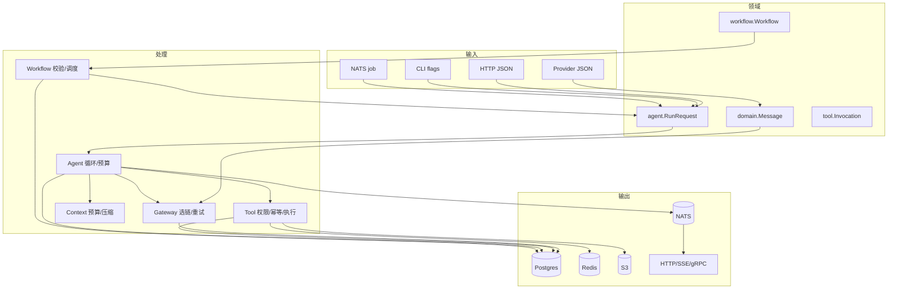

---

## 6. 状态管理

### 短期状态（进程内）

| 状态名 | 存储位置 | 生命周期 | 访问方式 |
|---|---|---|---|
| `CallBudget` | `gateway/types.go` | 单次 gateway 调用 | 局部对象，`TryAcquire` 唯一计数点 |
| 熔断状态 | `gateway/health.go` | 进程生命周期 | `HealthRegistry` 互斥表 |
| 本地限流窗口 | `gateway/ratelimit.go` | 进程生命周期 | 每 key 的请求/令牌窗口 + 并发计数 |
| 模型实例缓存 | `gateway/gateway.go:530` | 进程生命周期 | `(modelKey, kind)` → Chat/Embedding |
| 工具调用栈/次数 | `tool/callstate.go` | 单次运行（context 派生） | `WithCallState`，goroutine 隔离 |
| 无效重试熔断 | `tool/result.go` | 进程生命周期 | 参数指纹 → 连续失败次数 |
| 压缩摘要缓存 | `context/compact.go` | 进程生命周期 | 内容指纹 → 摘要；>512 清空 |
| 会话历史（无 DB） | `store/memstore` | 进程生命周期 | sessionID → messages |
| runBudget | `agent/runtime.go` | 单次运行 | 时间/成本/工具次数 |
| 取消集合 | `agent/runtime.go` | 进程生命周期 | runID → bool |

### 长期状态（跨进程/跨会话）

| 状态名 | 存储位置 | 生命周期 | 访问方式 |
|---|---|---|---|
| 会话/消息 | Postgres `sessions`/`messages` | 长期 | `SessionRepo`；按 session 串行分配 seq |
| 运行/步骤 | Postgres `runs`/`run_steps` | 长期 | `RunRepo` |
| 检查点 | Postgres `checkpoints`（append-only） | 长期 | `CheckpointRepo.Latest/Save/Unfinished` |
| 工具执行权威记录 | Postgres `tool_executions` | 长期（可按 TTL 清理） | `UNIQUE(scope, idem_key)` |
| 用量/丢弃 | Postgres `usage`/`usage_drops` | 长期 | `UsageRepo` |
| 事件 outbox | Postgres `events` | 长期（可按分区/时间归档） | `published_at IS NULL` |
| 记忆/审计 | Postgres `memory`/`memory_op_log` | 长期 | `MemoryRepo` |
| 向量 | Postgres `embeddings_768/1024` | 长期 | pgvector HNSW |
| 任务 | Postgres `tasks` | 长期 | `TaskRepo` |
| 工作流 | Postgres `workflow_runs`/`workflow_nodes` | 长期 | `WorkflowRepo` |
| 策略评测 | Postgres `strategy_eval` | 长期 | `StrategyEvalRepo` |
| 经验 | Postgres `experiences`/`experience_applications` | 长期 | `ExperienceRepo` |
| 大结果/产物 | S3/MinIO | 按 bucket lifecycle | `s3://` URI |
| 作业/事件流 | NATS JetStream | 7 天 / 2M 消息 | durable consumer |

### 缓存状态

| 状态名 | 存储位置 | 过期策略 | 更新策略 |
|---|---|---|---|
| 幂等结果 | Redis `tool:done:*` | `result_ttl_s`（默认 3600s） | `mark_done` 写入；PG 回填 |
| 幂等占用 | Redis `tool:claim:*` | `lease_s`（默认 120s） | `SET NX PX`；owner 校验释放 |
| 分布式限流 | Redis `rl:req|tok|conc:*` | 120s / 600s | Lua 原子检查+自增 |
| 取消信号 | Redis `run:cancel:*` | 30 分钟 | 控制面写入，worker 轮询 |
| 分布式锁 | Redis `lock:*` | 调用方指定 TTL | `SET NX` + owner 校验解锁 |
| 事件内存缓冲 | `event.Persistent.ch` | 进程退出时 drain | 500ms 或 200 条批量落库 |
| 用量账本 | `gateway.UsageLedger` | 有界 10,000 条 | 每 2s 落库；溢出丢弃并计数 |
| 阶段工具目录 | `app.staticCatalog` | 进程生命周期 | 启动时从 tool 服务拉取一次 |

### 读/写/清理

#### 读操作

| 状态 | 触发条件 | 读取位置 | 失败处理 |
|---|---|---|---|
| 检查点 | `resume=true` | `CheckpointRepo.Latest` | 读失败 → 从头跑并告警 |
| 工具执行 | 续跑判定 / 幂等确认 | `tool_executions` | 不可用 → 按副作用等级放行/拒绝 |
| 会话历史 | 每次运行前 | `messages` | 读取失败 → 无历史继续 |
| 记忆 | context 构建 | `memory` + 向量 | 失败 → 空召回并告警 |
| 策略评测 | 策略选择 | `strategy_eval` | 失败 → 跳过评测层 |
| 经验 | 失败恢复 | `experiences` | 失败 → 空结果 |

#### 写操作

| 状态 | 触发条件 | 写入位置 | 失败处理 |
|---|---|---|---|
| 检查点 | 每个工具批次 / 终态 | `checkpoints` | 只告警；续跑可能从头 |
| 工具结果 | 执行完成 | `tool_executions` + Redis | PG 失败 → 返回错误；Redis 失败 → 慢路径 |
| 用量 | 每次模型调用 | `usage` | 旁路告警；账本仍有记录 |
| 事件 | 各模块 emit | `events` | 旁路告警；缓冲丢弃计数 |
| 会话消息 | 运行前后 | `messages` | 旁路；影响历史不影响本次 |
| 记忆 | 会话结束/显式 Remember | `memory` + 向量 | 旁路；记忆是增益 |
| 任务状态 | 提交/运行/完成 | `tasks` | 失败影响查询，不影响执行 |

#### 清理操作

| 状态 | 触发条件 | 清理方式 |
|---|---|---|
| Redis claim | 租约到期 / `release` | TTL 自动过期；Lua 校验 owner 删除 |
| Redis done | TTL 到期 | 自动过期；PG 仍可回填 |
| 本地限流窗口 | 超过 60s | 每次 Acquire 惰性裁剪 |
| 压缩缓存 | 超过 512 条 | 整体清空（简单但会抖动） |
| 工具落盘 | 超过 `spill_ttl_hours` | 每次落盘时惰性清理 |
| 记忆 | 权重低于阈值 / valid_to 过期 | `Maintain` 转 tombstone |
| 经验 | 失效条件命中 | `Maintain` 转 deactivated（不删除） |
| NATS 事件 | 7 天 / 2M 条 | Stream 限制 |
| 用量账本 | 超过 10,000 条 | 丢最旧并累计 dropped |

### 跨边界状态

| 状态 | 跨任务 | 跨会话 | 跨进程 |
|---|---|---|---|
| 检查点 | ✅ 同 run_id 续跑 | ✅ | ✅ Postgres |
| 工具执行 | ✅ scope=run_id | ✅ | ✅ PG + Redis |
| 会话消息 | ❌ | ✅ | ✅ Postgres |
| 记忆 | ✅ | ✅（scope 决定） | ✅ PG + 向量 |
| 经验 | ✅ | ✅ | ✅ PG |
| 策略评测 | ✅ | ✅ | ✅ PG |
| 事件 outbox | ✅ | ✅ | ✅ PG + NATS |
| runBudget | ❌ | ❌ | ❌ 进程内，失败切换会重置 |
| 熔断状态 | ❌ | ❌ | ❌ 每副本独立（有意） |
| 取消集合 | ❌ | ❌ | ⚠️ Redis 取消键可跨进程，但内存集合不共享 |

### 一致性风险

1. **检查点、工具执行、消息、用量不在同一事务**：进程在“工具已执行、检查点未写”之间崩溃时，续跑依赖 `tool_executions` 的 `uncertain` 判定；这是设计选择，不是缺陷，但要求幂等层必须可靠。
2. **事件 outbox 至少一次**：relay 在事务提交后才发布，多个 relay 副本可能重复发布；消费方需按 `event_id` 去重。
3. **工作流资源容量只在单调度器内计数**：多副本 `orchestratord` 时，独占资源可能被并发占用（`resource_leases` 表已建但未使用）。
4. **runBudget 不持久化**：failover 后时间/成本预算重置，可能超过原预算。
5. **cancel 内存集合不清理**：同一 run_id 再次运行会立即被判取消（当前 run_id 全局唯一，风险低）。
6. **Redis 限流是固定分钟窗口**：边界处可能有短时突刺，不是严格滑动窗口。
7. **记忆维护无分布式锁**：多副本 `memoryd` 同时 `Maintain` 可能重复处理；tombstone 幂等，但会产生重复审计行。
8. **会话 seq 使用 advisory lock**：同 session 串行化正确，但高并发同会话写入会成为瓶颈。

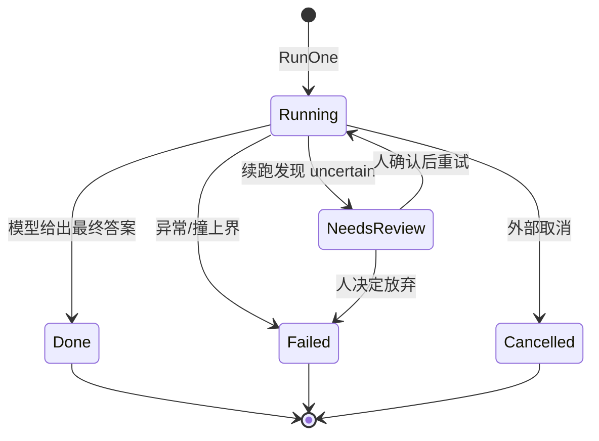

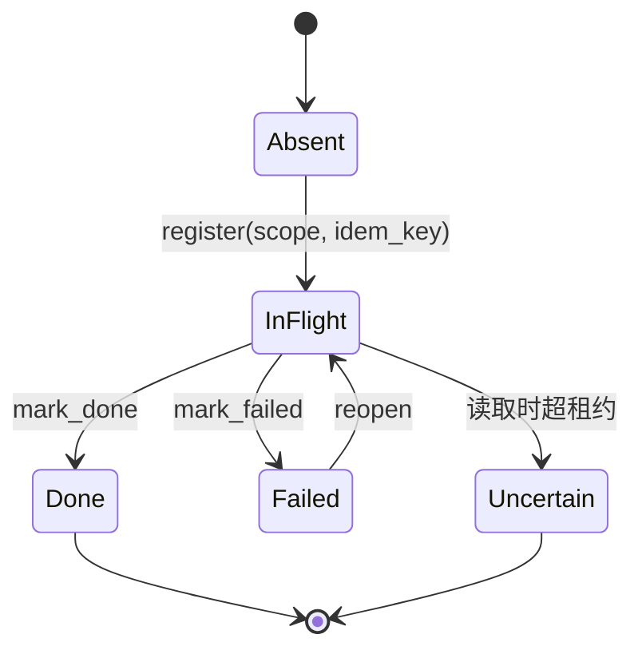

---

## 7. 依赖图

### 直接依赖（主要）

| 模块 | 依赖项 | 依赖方式 |
|---|---|---|
| `agent` | context, domain, event, foundation, gateway, tool | import / 接口 |
| `gateway` | domain, event, foundation, provider | import / 接口 |
| `tool` | domain, event, foundation | import |
| `context` | domain, event, foundation | import |
| `memory` | context（Turn/MemoryItem）, event | import |
| `strategy` | event | import |
| `workflow` | agent（Checkpoint/RunStatus）, event | import |
| `multiagent` | agent, workflow, event | import / 接口 |
| `store/postgres` | agent, domain, event, experience, gateway, memory, strategy, tool, workflow | 接口实现 |
| `transport` | agent, context, domain, experience, gateway, memory, multiagent, strategy, tool, workflow | 转换/客户端 |
| `composition` | 全部业务模块 + store + transport + tool/builtin | import |
| `app` | composition + 全部 service + transport + store | import |
| `service/*d` | 对应领域包 + transport（controld 另含 composition） | import |

### 反向依赖（被依赖，入度 ≥ 3）

| 模块 | 被谁依赖 | 入度 |
|---|---|---|
| `foundation/ids` | 15 个包 | 15 |
| `domain` | agent, app, composition, context, gateway, provider, service/controld, store/*, tool, transport | 12 |
| `event` | agent, composition, context, experience, gateway, memory, multiagent, controld, store/postgres, strategy, tool, workflow | 12 |
| `tool` | agent, app, composition, toold, memstore, postgres, redis, builtin, transport | 9 |
| `agent` | app, composition, multiagent, agentd, controld, memstore, postgres, transport, workflow | 9 |
| `transport` | app + 8 个 service | 9 |
| `gateway` | agent, app, composition, gatewayd, postgres, redis, transport | 7 |
| `context` | agent, app, composition, memory, controld, memoryd, transport | 7 |
| `workflow` | app, composition, multiagent, controld, workflowd, postgres, transport | 7 |

### 枢纽模块

| 排名 | 模块 | 被依赖次数 | 重要性说明 |
|---|---|---|---|
| 1 | `internal/domain` | 12 | 跨层词汇表；改动会波及所有模块（也说明它应该保持稳定、只增不改） |
| 2 | `internal/event` | 12 | 统一观测出口；几乎所有模块都发事件 |
| 3 | `internal/agent` / `internal/tool` / `internal/transport` | 9 | 运行时核心、副作用边界、协议转换层 |
| 4 | `internal/gateway` / `context` / `workflow` | 7 | 模型入口、上下文入口、编排入口 |

> `foundation/ids` 入度最高，但它是纯工具函数，不构成架构耦合风险；真正需要关注的是 `domain` 与 `event`。

### 耦合分析

#### 高内聚低耦合

- `internal/context`：只依赖 domain/event/ids，压缩、预算、组装自洽。
- `internal/workflow`：只依赖 agent 的检查点接口与 event；DAG 校验/调度独立可测。
- `internal/tool`：工具契约、权限、幂等、结果处置都在包内，外部只通过 `Invoke`。
- `internal/strategy`：只依赖 event，注册/契约/模板/选择自洽。

#### 强耦合

- `internal/store/postgres`：同时实现 6 个领域包的接口，导入面很宽。**这是适配器层的正常代价**，但意味着领域类型变更会同时影响 SQL 映射。
- `internal/transport`：导入 10 个领域包做 proto 转换。**转换层天然宽**，但若 proto 频繁变更，会成为改动热点。
- `internal/service/controld`：导入了 `composition`（为了单机 all 模式的本地运行时）。这让控制面与组合根耦合；分布式模式下它并不需要 composition，只是为 `LocalRuntime` 服务。

#### 循环依赖

脚本扫描 127 个非测试 Go 文件：**未发现 import cycle**。

#### 上帝模块

| 模块 | 规模 | 判断 |
|---|---|---|
| `internal/composition` | 10 文件 1,129 行 | **有意为之的组合根**。它必须知道所有模块，这是依赖注入的代价；它不被任何业务模块反向依赖。 |
| `internal/app` | 3 文件 1,262 行 | 入口编排 + 角色启动 + worker。职责偏多，但都是“进程级编排”，不含领域算法。 |
| `internal/gateway` | 12 文件 2,191 行 | 不是上帝模块，而是**一个复杂子系统**：选链、健康、限流、计价、账本各自分文件。 |
| `internal/service/controld` | 1 文件 762 行 | 单文件偏大；HTTP handler + SSE + 内存任务表 + outbox relay 混在一起，后续可拆分。 |

### 依赖方式统计

| 方式 | 数量（观察） | 示例 |
|---|---|---|
| import | 大多数 | gateway → provider；workflow → agent |
| 接口 | 8+ | `agent.ChatClient`、`agent.ToolInvoker`、`agent.ContextBuilder`、`tool.ExecutionRepo`、`workflow.NodeRunner`、`memory.Store` |
| 事件 | 各模块 | `gateway.*`、`tool.*`、`agent.*`、`context.*`、`memory.*`、`workflow.*`、`experience.*` |
| 注册表 | 5 | 模型注册表、工具注册表、阶段注册表、策略注册表、Agent Pool |
| 反射 | 0 | 未使用反射做扩展 |

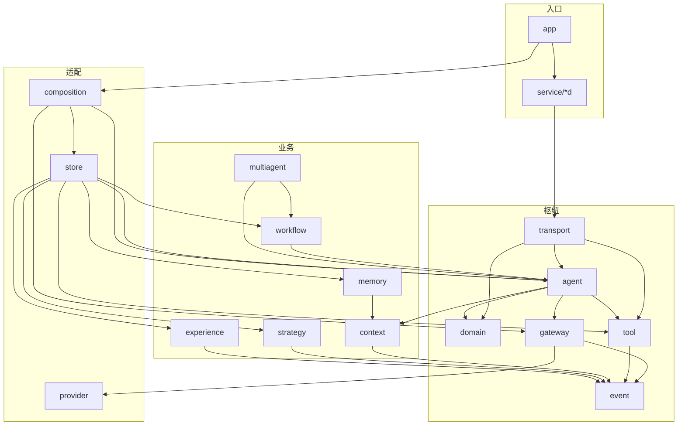

---

## 8. 配置分析

### 配置入口

#### 环境变量

| 变量名 | 默认值 | 作用 | 必需 |
|---|---|---|---|
| `BESA_ENV` | `dev` | 选择 `<env>.yaml` | 否 |
| `BESA_CONFIG_DIR` | `configs` / `../configs` | 配置目录 | 否 |
| `BESA_POSTGRES_DSN` | base 中的默认 DSN | 覆盖 `postgres.dsn` | 分布式必需 |
| `BESA_REDIS_URL` | base 中的默认 URL | 覆盖 `redis.url` | 分布式建议/部分角色必需 |
| `BESA_NATS_URL` | `nats://127.0.0.1:4222` | 覆盖 `nats.url` | 分布式必需 |
| `BESA_LOG_LEVEL` | 配置值 | 覆盖 `logging.level` | 否 |
| `BESA_S3_ENDPOINT` | 空 | 对象存储端点 | 分布式大结果必需 |
| `MINIO_ACCESS_KEY` / `MINIO_SECRET_KEY` | 空 | S3 凭据（只存变量名） | 配 S3 时必需 |
| `BESA_WORKDIR` | `.` / `/workspace` | 工具可访问根目录 | 否 |
| 模型密钥 | 空 | `DEEPSEEK_API_KEY` / `OPENAI_API_KEY` / `DASHSCOPE_API_KEY` | 接真实厂商时 |

#### 配置文件

| 文件路径 | 格式 | 用途 | 加载时机 |
|---|---|---|---|
| `configs/base.yaml` | YAML | 全环境默认值，默认 mock | 每次启动 |
| `configs/<env>.yaml` | YAML | 环境覆盖（dev/test/prod） | 每次启动 |
| `configs/workflows/*.yaml` | YAML | 预定义工作流 | `workflow.LoadTemplate` 时 |
| `.env`（未提交） | dotenv | 密钥/DSN 等 | 配置加载前读取 |

#### 命令行参数

| 参数名 | 默认值 | 作用 | 示例 |
|---|---|---|---|
| `--env` | `BESA_ENV` / `dev` | 配置环境 | `--env test` |
| `--config` | `configs` | 配置目录 | `--config /etc/besa` |
| `--role` | `all` | 服务角色 | `--env prod serve --role agent` |
| `--addr` | 配置端口 | 覆盖监听地址 | `--addr :9101` |
| `--stage` | 自动路由 | 固定阶段 | `--stage test_case` |
| `--session` | 自动生成 | 会话 id | `--session s1` |
| `--resume` / `--run-id` | false / 空 | 续跑 | `--resume --run-id run_x` |
| `--input` | `{}` | 工作流输入 JSON | `--input '{"task":"..."}'` |

#### 远程配置

**未实现**。配置只来自本地文件/环境变量；无配置中心、无热更新。

### 配置优先级

从高到低（加载期）：

1. `BESA_POSTGRES_DSN` / `BESA_REDIS_URL` / `BESA_LOG_LEVEL` 固定覆盖；
2. 进程环境变量 / `.env`（用于 `${VAR}` 插值）；
3. `<env>.yaml`；
4. `base.yaml`；
5. 代码内默认值（`cfg.X(..., default)`）。

> 注意：CLI 参数只选择环境/目录与少量运行时行为，**不能直接覆盖任意配置键**。

### 关键配置项 TOP 5

| 排名 | 配置项 | 影响 | 推荐值 |
|---|---|---|---|
| 1 | `gateway.aliases.*.candidates` + `models.*` | 决定模型可用性与降级链；配错直接影响所有调用 | 生产至少一个真实候选 + mock 兜底 |
| 2 | `agent.limits.{max_steps,deadline_s,max_tool_calls}` | 决定一次运行的成本/时间上界；没有“不限” | 按任务复杂度设置，保留 tool 上界 |
| 3 | `tool.permission.levels` / `scope` | 决定工具能否读写、能访问哪些目录；默认拒绝 | 最小权限 + 明确 workdir |
| 4 | `artifact.endpoint` + `client.*` | 分布式大结果/服务发现；配错会导致工具输出不可回捞或服务不可达 | 生产配 MinIO + Service DNS |
| 5 | `workflow.auto.allow` / `experience.enabled` / `memory.enabled` | 决定自动建图、经验闭环、长期记忆是否开启 | 按成熟度逐步开启；记忆默认关闭 |

### 环境差异

| 配置项 | dev | test | prod |
|---|---|---|---|
| 日志 | DEBUG，文本 | WARNING | INFO，JSON |
| 模型候选 | deepseek/qwen/mock | mock | mock（可换真实） |
| Postgres | 默认本地 DSN | `disabled` | 环境注入 |
| Redis | 默认本地 | `disabled` | 环境注入 |
| NATS | 默认本地 | `disabled` | 环境注入 |
| 限流 | 进程内 | 关闭 | Redis 分布式 |
| 记忆 | 默认关 | 默认关 | 开启 |
| 工作流 auto | 默认关 | 默认关 | 开启 |
| 经验 | 默认关 | 默认关 | 开启 |
| embedding 维度 | 1024（base） | 768 | 768 |

```mermaid
flowchart TD
    A[启动] --> B[CLI 解析 --env/--config]
    B --> C[读取 .env + 进程环境]
    C --> D[加载 base.yaml]
    D --> E[深度合并 env.yaml]
    E --> F[${VAR} 插值]
    F --> G[固定环境变量覆盖]
    G --> H[Section/Get 读取]
    H --> I[启动期校验: 厂商/候选/策略]
    I --> J[运行时默认值兜底]
```

---

## 9. 核心机制（系统“心脏”）

### 机制 1：Gateway 策略链

- 位置：`internal/gateway/gateway.go:125/357`，`router.go:12`，`health.go`，`ratelimit.go`，`retry.go`
- 职责：把“用哪个模型、挂了怎么办、花多少”收敛为一个方法
- 复杂性评分：5/5

#### 逻辑说明

1. **能力推导**：请求形态（stream/tools/vision/json）→ 必需能力集合；选链时结构性地排除不满足的候选。
2. **选链**：按配置策略顺序执行 `capability → priority/weight/cost/health`；不可用模型（缺密钥）在选链阶段过滤。
3. **单候选执行**：熔断 → 限流 → 预算 → 调 provider → 成功/失败记录。
4. **重试**：只在 `Retryable` 且未超单候选上限且退避不超过剩余预算时重试；`CallBudget` 是唯一计数点。
5. **降级**：候选失败后按固定顺序决定是否换下一个；顺序 `stream_committed → disabled → no_more_candidates → budget → proceed`。
6. **收尾**：计价、写入账本、发事件；`degraded = index > 0`。

#### 伪代码

```
chain = select(candidates, requiredCapabilities, strategy)
budget = CallBudget(totalMaxAttempts, deadline)
for index, spec in chain:
    if circuitOpen(spec): record skipped; continue
    if !limiter.acquire(spec): record skipped; continue
    for attempt in 0..perCandidateMax:
        if !budget.tryAcquire(): record skipped; break
        try:
            resp = provider.chat(spec, request)
            circuit.success(spec); limiter.reconcile(); return finalize(resp, index)
        catch err:
            usage.recordFailure()
            circuit.failure(spec)
            if !err.retryable or attempt exhausted or backoff > remaining: break
            sleep(backoff)
    decision = fallback.decide(...)
    if !decision.proceed: raise terminal(decision.reason)
```

#### 架构作用

- 业务方只认 alias，换模型 = 改配置；
- 把 provider 的重试收敛在网络层，避免“两层重试相乘”；
- 熔断/限流/预算都在同一处编排，顺序可审计。

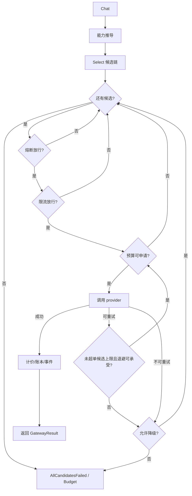

### 机制 2：工具幂等两阶段 + 读取时 uncertain

- 位置：`internal/tool/idempotency.go:145`，`internal/tool/executor.go:62`，`internal/store/redis/redis.go:74`，`internal/store/postgres/toolexec.go`
- 职责：保证“同一个调用无论提交几次，副作用只发生一次”
- 复杂性评分：5/5

#### 逻辑说明

1. 键：显式 `idempotency_key` 优先，否则 `scope + SHA256(tool_name + sorted_json(args))`。
2. 快路径：Redis Lua 一次完成“查 done → SET NX claim → 返回 in_flight”。
3. 权威确认：PG `tool_executions(scope, idem_key)` 唯一约束。
4. 状态：
   - `done` → 复用结果；
   - `in_flight` / `uncertain` → 不执行；
   - `failed` → `reopen` 后执行；
   - 无记录 → `register` 后执行。
5. 执行后 `mark_done`（缓存结果）或 `mark_failed`（释放租约）。
6. 读取时：`in_flight` 且 `now - started_at > lease` → `uncertain`，**不写回**。

#### 伪代码

```
key = explicitKey or scope + ":" + sha256(tool + canonicalJSON(args))
if redis.available:
    state = redis.claim(key, owner, lease)   // Lua 原子
    if state == done: return reused
    if state == in_flight: return in_flight
row = pg.find(scope, key, lease)
if row == nil: pg.register(scope, key, owner)
if row.done: return reused
if row.in_flight or row.uncertain: return row.state
if row.failed: pg.reopen(scope, key, owner)
execute()
pg.mark_done(result) / redis.mark_done(result)
```

#### 架构作用

- Redis 是快路径，PG 是权威：清 Redis 不会让去重失效；
- `uncertain` 把“不知道”显式化，让上层决定重做/放弃；
- 与 agent 的 `needs_review` 直接对接。

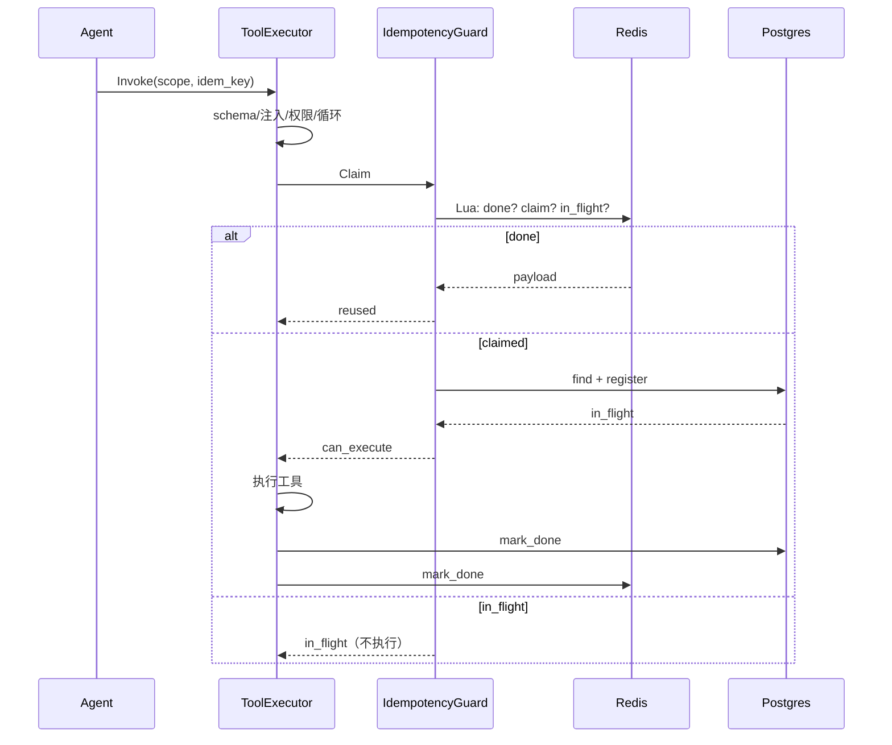

### 机制 3：Agent 运行状态机 + 续跑判定

- 位置：`internal/agent/runtime.go:124/286`，`executor.go:66`，`checkpoint.go`
- 职责：把“跑到一半”变成可判定、可决策、可解释的状态
- 复杂性评分：5/5

#### 逻辑说明

1. 路由阶段（显式 → 规则 → LLM → `on_unknown`）。
2. 续跑判定：
   - 无快照 → 从头；
   - `needs_review` → 继续 `needs_review`；
   - 已完成 → 重跑；
   - `running` → 还原 `TaskRun`，用 `idem_keys` 查 `tool_executions`：
     - 有 `uncertain` → 按策略（默认 `needs_review`）；
     - 无 → 从下一步继续。
3. 预算：deadline / max_steps / max_tool_calls / max_cost；`stopReason` 在每步开始检查。
4. 循环：调模型 → 有工具调用则串行执行 → 回填 → 记录步骤 → 写 running 检查点。
5. 收尾：终态检查点 + 事件 + 记忆沉淀（旁路）。

#### 伪代码

```
runId = runId or uuid
budget.start()
decision = router.route(task, stage)
if decision.needs_input: return needs_review
resumed, kind, reason = decideResume(runId, resume)
if kind in {needs_review, abort}: saveTerminal; return
messages = context.build(history, current) or [system,user]
result = executor.run(agent, messages,
    prepare=compactByStep,
    remaining=budget.remaining,
    stopReason=budget.stopReason,
    onProgress=budget.update)
status = result.status
if cancelled and failed: status = cancelled
finish(outcome)   // checkpoint + event + settle
```

#### 架构作用

- 续跑不靠猜：`uncertain` 是唯一判据；
- 预算三层传导，避免“每次不超时、合起来超时”；
- 运行内压缩按“步”，不切断工具配对。

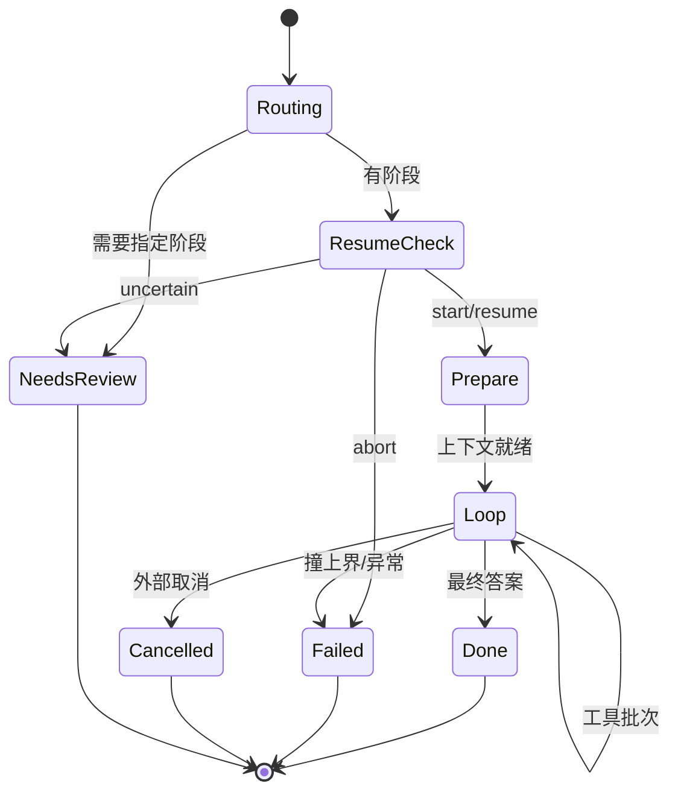

### 机制 4：上下文预算 + 按步压缩

- 位置：`internal/context/manager.go:81`，`compact.go:51`，`budget.go`，`builder.go`
- 职责：在模型窗口内决定“看什么”，并尽量少丢信息
- 复杂性评分：4/5

#### 逻辑说明

1. 预算：`available = window - reserve_output - safety_margin`；先扣 system + current，再按比例分配给 window/transition/session_summary/long_term；不足下限的段整段不注入。
2. 切分：`by_turn` 以 user 为界；`by_step` 以 assistant 为界（运行内必须按步）。
3. L1（零成本）：去噪 + 截断长工具输出，**不删除消息**，保持配对。
4. L2：把旧段交给 LLM 压成“已完成的操作与结论”。
5. L3：把 L2 摘要再压成要点。
6. 缓存：按 `promptVersion + level + content` 缓存摘要；最多 512 条。
7. 去重：只对长度 ≥ 40 的块；原文优先于摘要。
8. 组装：system 置顶，当前输入最后；工具消息缺配对 id 时降级为 user 文本并标注。

#### 伪代码

```
plan = planBudget(window, demands)
blocks = strategy.collect(history, target=plan.allocated[window])
blocks += memory.recall(...)
blocks = dedupe(blocks)
for seg in [window, transition, summary, long_term]:
    keep = fit(blocks[seg], plan.used[seg])
messages = buildMessages(system, current, keep)
```

#### 架构作用

- 解决“单次运行内部消息全在同一轮、按轮切压不掉”的问题；
- L1 不花钱先做，L2/L3 才调用模型；
- 预算与降级可见，避免“看起来正常但模型没看到关键信息”。

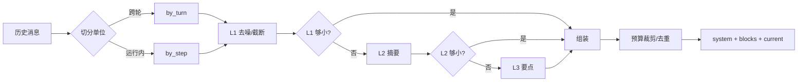

### 机制 5：Workflow DAG 校验与调度

- 位置：`internal/workflow/validate.go:18`，`engine.go:58`，`planner.go:29`
- 职责：把“任务 → 能力 → 执行图”变成可校验、可调度、可恢复的运行
- 复杂性评分：4/5

#### 逻辑说明

1. Planner 生成候选图（预定义/模板/auto），每个节点带 `reason`。
2. Validator 五类检查**按固定顺序**：依赖闭合 → 无环 → IO 匹配 → 权限 → 资源；fail-closed。
3. Scheduler 每轮计算就绪节点：数据上游 `SUCCEEDED` + 独占资源可获取 + 并行额度。
4. 并发执行一批节点；失败按 `RetryMax` 重试，optional 节点跳过，否则失败。
5. 下游节点若依赖失败/跳过节点，则 `SKIPPED`。
6. 每个节点写图级检查点（`node_id = <wfRunID>:<nodeID>`）。

#### 伪代码

```
issues = validate(workflow)
if issues not empty: reject
states = PENDING
while not done:
    propagateSkipped()
    ready = nodes where pending and upstream succeeded and resource available
    batch = ready[:maxParallel]
    results = parallel run(batch)
    for result in results:
        if success: outputs[id]=...; checkpoint
        else if retryable and attempts<retryMax: state=PENDING
        else if optional: state=SKIPPED
        else: state=FAILED
```

#### 架构作用

- 能力匹配、依赖推导、DAG 校验、资源调度都是确定性代码；
- LLM 只可能在 Planner 候选生成里，且必须过 Validator；
- 节点失败局部处理，不需要整图重跑。

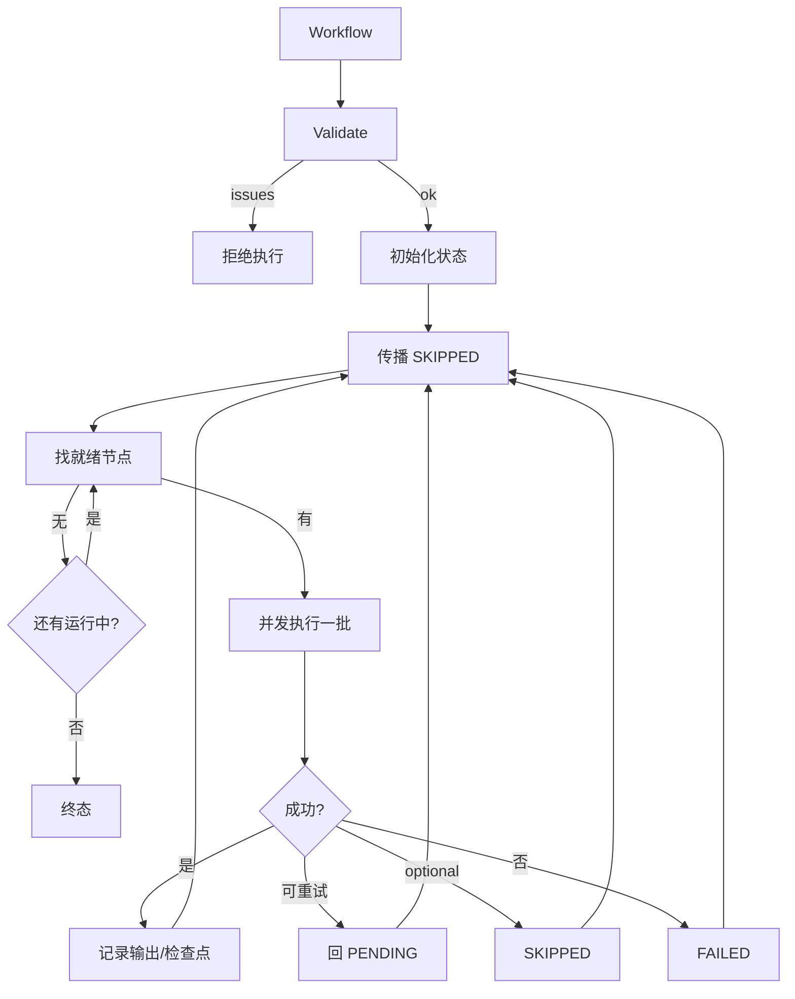

### 复杂性来源

| 来源 | 涉及机制 | 说明 |
|---|---|---|
| 业务复杂度 | Agent / Workflow / Memory | 七个测试阶段、DAG 依赖、记忆冲突判定 |
| 技术复杂度 | Gateway / Tool | 多厂商协议、重试/降级/熔断/限流/幂等/租约 |
| 集成复杂度 | 分布式全链路 | gRPC、NATS、Postgres、Redis、S3 的失败模式与一致性 |
| 状态复杂度 | 续跑/工作流 | 检查点、uncertain、节点状态、资源占用 |

---

## 10. 错误处理

### 错误模型

#### 异常/错误类型

| 类型 | 触发条件 | 处理方式 | 传播路径 |
|---|---|---|---|
| `provider.Error`（network/timeout/http/parse/config） | 厂商网络/HTTP/解析失败 | `Retryable` 决定 gateway 是否重试 | provider → gateway |
| `CapabilityError` | 模型不支持请求所需能力 | 本地拦截，零网络调用 | provider / gateway |
| `UnknownAliasError` | 逻辑名拼错 | 列出可用 alias | gateway → 调用方 |
| `NoCapableModelError` | 候选都不满足能力 | 列出每个候选缺失原因 | gateway → 调用方 |
| `AllCandidatesFailedError` | 候选链耗尽 | 保留每次 attempt | gateway → agent |
| `BudgetExhaustedError` | 重试/时间预算耗尽 | 明确撞的是哪一个上界 | gateway → agent |
| `StreamCommittedError` | 流式已输出正文后失败 | 禁止重试/降级 | gateway → 调用方 |
| `tool.Result` 非 OK | 参数/权限/注入/执行失败 | **业务失败作为结果返回**，不冒泡；基础设施错误才可能冒泡 | tool → agent |
| `workflow.GraphIssue` | 图校验失败 | fail-closed，一个节点都不跑 | workflow → 调用方 |
| `errs.Error` | 通用错误码 | 传输层映射 gRPC/HTTP | 跨层 |

#### 错误码设计

| 错误码/类别 | 含义 | 处理建议 |
|---|---|---|
| `invalid` | 参数/配置非法 | 修配置或调用参数 |
| `not_found` | 任务/会话/别名不存在 | 先创建或修正 id |
| `conflict` | 并发/唯一约束冲突 | 重读后重试 |
| `unavailable` | 依赖不可用 | 检查服务/网络 |
| `rate_limited` | 配额耗尽 | 等待或换候选 |
| `budget_exhausted` | 预算耗尽 | 调大预算或排查死循环 |
| `upstream` | 上游厂商错误 | 看 attempt 原因 |
| `cancelled` | 外部取消 | 不需要重试 |
| `needs_review`（状态） | 需要人处理 | 人工确认 uncertain 工具调用 |

### 恢复机制

#### 重试机制

| 场景 | 重试次数 | 重试间隔 | 放弃条件 |
|---|---|---|---|
| provider 网络层 | `models.*.retries`（默认 1） | `backoff_s` + jitter | 非网络错误 / 父 ctx 取消 |
| gateway 候选内 | `max_attempts_per_candidate`（默认 2） | 指数退避 + jitter | 不可重试 / 单候选上限 / 退避 > 剩余预算 |
| gateway 跨候选 | `total_max_attempts`（默认 4） | — | `CallBudget` 耗尽 |
| workflow 节点 | `retry_max`（默认 1） | 立即重新入队 | 不可重试 / optional / 超上限 |
| tool 无效重试 | 连续失败 3 次后拒绝 | — | 参数指纹相同且未成功 |
| 记忆 LLM 判定 | 不重试 | — | 失败按 `on_unavailable`（默认 reject） |

#### 降级策略

| 场景 | 降级方案 | 触发条件 |
|---|---|---|
| 候选失败 | 换下一个候选；`degraded=true` | fallback enabled 且还有候选 |
| 流式已输出 | 禁止降级 | 已产生 chunk |
| 模型缺密钥 | 启动期标记不可用，选链过滤 | 注册期 |
| 幂等不可用 | 只读放行并标 `executed_degraded`；写拒绝 | PG/Redis 不可用 |
| 记忆不可用 | 空召回/不写入；context 继续 | 记忆服务失败 |
| 策略选择失败 | 回落 baseline，`degraded=true` | 无模板/规则/评测数据 |
| 上下文预算不足 | 标记 degraded；固定段不截断 | system+current 超可用输入 |
| 事件/用量落库失败 | 告警，不影响主流程 | DB 异常 |

#### 熔断机制

| 服务 | 熔断条件 | 恢复条件 |
|---|---|---|
| 每个模型 key | 连续失败 ≥ `failure_threshold`（默认 5） | 冷却 `cooldown_s` 后进入半开；半开连续成功 `half_open_probes` 次恢复 |
| 半开 | 任一失败立刻回 OPEN | 冷却后再次半开 |
| 取消 | 不记为失败 | 不污染熔断计数 |

#### 回滚/补偿

| 操作 | 回滚条件 | 处理 |
|---|---|---|
| 工具执行失败 | 工具返回 failed/refused | 不自动回滚副作用；结果回给模型，由模型决定下一步 |
| 工具 uncertain | 读取时超租约 | 不自动重试；上层 `needs_review`/abort/retry_uncertain |
| 工作流节点失败 | 可重试 → 重新入队；optional → 跳过 | 下游依赖失败则 SKIPPED |
| 记忆合并/更新 | 冲突 | 新来源更强/更新 → 新建版本并 supersede；否则记录冲突 |
| 经验应用无效 | 连续 bad uses | degraded → deactivated（不删除） |

### 日志设计

| 日志级别 | 使用场景 | 示例 |
|---|---|---|
| ERROR | 检查点写入失败、终态持久化失败、panic | `检查点写入失败...` |
| WARN | 降级、Redis/NATS 不可用、LLM 路由失败、记忆旁路失败 | `发生降级`、`Redis 不可用...` |
| INFO | 服务启动、工具目录加载、记忆维护完成、装配完成 | `gRPC 服务已启动` |
| DEBUG | 事件发布失败、缓存回填失败、调试细节 | `事件发布失败` |

日志带 `trace_id`（context 传播），错误文本经 `errs.Redact` 脱敏。

### 脆弱点分析

| 排名 | 位置 | 风险描述 | 建议改进 |
|---|---|---|---|
| 1 | `store/postgres` | 未在真实 PG 执行迁移；JSONB/JSON 绑定、pgvector 维度、唯一索引都只经过代码审查 | 加 Testcontainers/Compose 集成测试，CI 跑迁移与仓储 CRUD |
| 2 | `workflow/engine.go` | 资源容量只在单调度器内计数；多副本 orchestrator 会超卖独占资源 | 使用 `resource_leases` 表 + 租约/心跳，或限制单副本 |
| 3 | `agent/runtime.go` | runBudget 不持久化；failover 后预算重置 | 从 usage/run_steps 重建预算，或把预算写入 checkpoint |
| 4 | `service/controld` | 客户端 `grpc.NewClient` 懒连接，服务不可达时同步接口会等到 60s 超时 | 加 circuit/短超时 + 明确 503 |
| 5 | `memory/policy.go` | LLM 判定默认 fail-closed；LLM 故障时记忆全部拒绝（安全但影响体验） | 配置可观测的降级指标，按场景允许 `allow` |
| 6 | `tool/builtin/bash.go` | soft sandbox 只做超时/输出/环境变量清理；CPU/内存/网络限制未强制 | 生产使用容器/Job Object 隔离，或禁用 bash |
| 7 | `transport` | 内网 gRPC 明文；控制面 REST 无鉴权 | 加 mTLS、API 鉴权、限流/审计 |
| 8 | `event/nats.go` | 无 DB 时事件直接 core NATS 发布，不可回放 | 生产必须配 DB（outbox）或显式接受丢失 |
| 9 | `context/compact.go` | 摘要失败保留 L1，可能仍超窗口；只标记 insufficient | 提升到 L3 或强制截断并明确告警 |
| 10 | `app/worker.go` | 取消靠 2s 轮询 Redis，最长延迟 2s | 订阅 NATS 取消主题（已发布 `agent.cancel`，可改为订阅） |

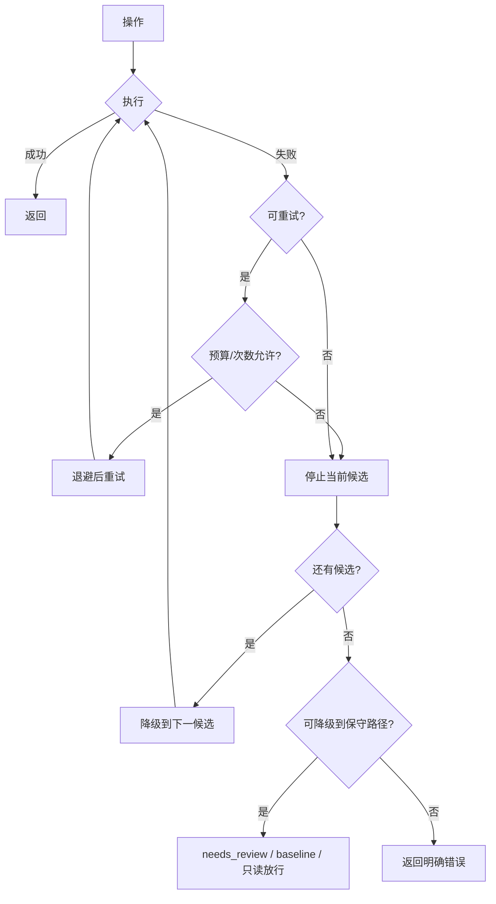

---

## 11. 测试分析

### 测试类型

#### 单元测试

| 测试文件 | 覆盖模块 | 测试数量 | 覆盖内容 |
|---|---|---|---|
| `internal/gateway/gateway_test.go` | gateway | 5 | 降级、未知 alias、熔断、重试、成本 |
| `internal/tool/executor_test.go` | tool | 6 | 幂等复用、权限、路径穿越、uncertain、schema、幂等不可用 |
| `internal/agent/runtime_test.go` | agent | 5 | 路由、工具循环、步数上界、uncertain 续跑、abort |
| `internal/context/context_test.go` | context | 5 | 预算不足、按步压缩、L2 摘要、组装、去重 |
| `internal/workflow/engine_test.go` | workflow | 5 | 校验、依赖顺序、失败传播、重试、fail-closed |
| `internal/strategy/selector_test.go` | strategy | 4 | 模板选择、高风险拒绝、契约、组合枚举 |
| `internal/memory/memory_test.go` | memory | 4 | 哈希归一化、闸门/PII、衰减、关键词检索 |
| `internal/experience/experience_test.go` | experience | 5 | needs_review、分类/恢复、门控、应用降级 |
| `internal/foundation/config/config_test.go` | config | 2 | 深度合并/插值、缺失变量报错 |
| **合计** | 9 个包 | **41** | 部分语句覆盖率：strategy 41.1%、tool 52.4%、workflow 53.1%（其余包因工具链版本不一致未测出） |

#### 集成测试

**无**（未发现 `integration/`、Testcontainers、Compose 测试）。

#### 端到端测试

**无**（未发现启动真实服务 + HTTP/gRPC 的 E2E 用例）。

### 测试辅助设计

#### Mock 设计

| Mock 对象 | Mock 方式 | 使用场景 |
|---|---|---|
| `fakeChat` | 实现 `agent.ChatClient`，按调用次数返回工具调用/最终答案 | agent 循环 |
| `fakeTools` | 实现 `agent.ToolInvoker` | 工具调用计数 |
| `uncertainFinder` | 实现 `agent.ToolFinder`，固定返回 uncertain | 续跑判定 |
| `fakeProvider/fakeChat` | 实现 provider 接口，可注入错误/响应 | gateway 重试/降级/熔断 |
| `fakeSummarizer` | 实现 `context.Summarizer` | L2 压缩 |
| `FakeClock` | `foundation/clock` | 时间相关测试（已实现，未在测试中广泛使用） |

#### Fixture 设计

| Fixture | 用途 | 数据来源 |
|---|---|---|
| `t.TempDir()` | 工具读写范围 | 临时目录 |
| 内嵌 YAML 字符串 | 配置合并 | `config_test.go` |
| `memstore.Checkpoints` | 检查点 | 内存 |
| `memory.MemoryStore` | 记忆 | 内存 |

#### Test Helper

| Helper | 功能 | 使用场景 |
|---|---|---|
| `newTestExecutor` | 构建 registry/permission/guard/executor | tool 测试 |
| `buildRuntime` | 构建 router/executor/runtime | agent 测试 |
| `testGateway` | 构建 registry + fake provider | gateway 测试 |
| `twoNodePool` | 构建两节点 DAG | workflow 测试 |
| `testRegistry/testTemplates` | 策略注册与模板 | strategy 测试 |

### 覆盖度分析

#### 核心模块覆盖

| 模块 | 重要程度 | 测试覆盖 | 缺口评估 |
|---|---|---|---|
| gateway | 高 | 5 个测试，覆盖主策略链 | 未测流式、限流等待、半开恢复、usage 溢出 |
| tool | 高 | 6 个测试，覆盖幂等/权限/注入/租约 | 未测 bash、grep、大结果 spill、schema 缓存 |
| agent | 高 | 5 个测试，覆盖循环/续跑 | 未测 context 压缩钩子、预算成本上界、取消 |
| context | 高 | 5 个测试 | 未测 tiered、memory 注入、rehydrate、预算分配细节 |
| workflow | 高 | 5 个测试 | 未测资源容量、并行批、图级检查点、auto 规划 |
| memory | 中 | 4 个测试 | 未测 PG 仓储/向量、LLM 提取/判定、维护批次 |
| strategy | 中 | 4 个测试 | 未测评测层、规则层、裁剪 |
| experience | 中 | 5 个测试 | 未测 PG 仓储、维护/失效、冲突 |
| composition/store/service/transport/app | 高（集成） | **0** | 最大缺口：分布式链路没有自动化验证 |
| provider | 中 | **0** | OpenAI 兼容协议/SSE 解析未测 |

#### 高风险未测点

| 排名 | 位置 | 风险描述 | 建议测试 |
|---|---|---|---|
| 1 | `store/postgres` + `migrations` | SQL/JSONB/pgvector 只在代码层审查 | Testcontainers 起 PG，跑迁移 + 仓储 CRUD + 向量检索 |
| 2 | `internal/app/serve.go` + `worker.go` | 角色启动、NATS 消费、任务状态回写没有测试 | Compose 集成测试：提交任务 → 轮询完成 |
| 3 | `internal/transport/convert.go` | proto 双向转换字段遗漏只能靠编译 | round-trip property test |
| 4 | `internal/provider/compat.go` | SSE 解析、tool_calls、reasoning、usage 解析 | httptest 模拟 OpenAI 响应 |
| 5 | `internal/service/controld` | HTTP 参数校验、SSE 过滤、取消语义 | httptest + 真实 handler |
| 6 | `internal/workflow/engine.go` | 并行批次/资源容量/失败传播 | 多节点/资源冲突测试 |
| 7 | `internal/memory` PG 路径 | 向量写入与检索、事务 | pgvector 集成测试 |
| 8 | `internal/strategy` 评测层 | 版本匹配/打分 | 固定 EvalRecord 测试 |

### 测试质量评估

**优点**：

- 测试不是“覆盖率装饰”，而是直接验证了架构纪律：`uncertain` 续跑、幂等复用、权限先于执行、按步压缩不破坏配对、高风险策略拒绝降级、经验未验证不入库。
- 使用真实临时文件/内存仓储，不依赖外部服务，CI 友好。
- 失败断言具体（如“熔断后上游零调用”“reused 不应报告副作用”）。

**不足**：

- **没有任何跨进程/跨存储测试**；Go 版的分布式是本项目最大的风险面，却完全没有自动化验证。
- 没有 CI 配置（`.github/workflows` 缺失），测试靠手工运行。
- 覆盖率只测得一部分（strategy 41.1% / tool 52.4% / workflow 53.1%）；其余包因 Go 工具链版本不一致未测出。
- 真实厂商协议、SSE、pgvector、NATS durable 语义均未测试。

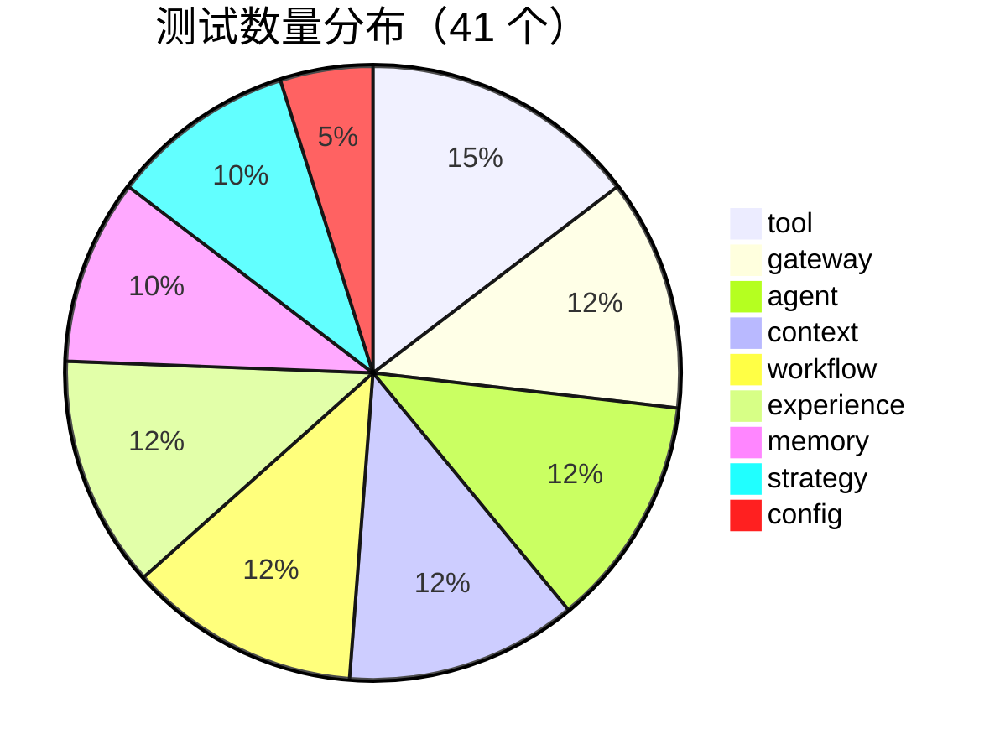

---

## 12. 性能与并发

### 性能特征

#### IO 密集路径

| 路径 | IO 类型 | 频率 | 说明 |
|---|---|---|---|
| `agent → gateway` | gRPC + 上游 HTTP | 每步一次 | 模型调用是主要延迟来源 |
| `agent → tool` | gRPC + 文件/子进程 | 每个工具调用 | bash 可能长耗时 |
| `tool → Postgres` | SQL | 每次调用 claim/mark | 幂等权威记录 |
| `tool → Redis` | Redis Lua | 每次调用 | 快路径，通常 <1ms |
| `agent → Postgres` | SQL | 每步/终态 | 检查点、消息 |
| `control → NATS` | 发布 | 每任务一次 | JetStream ack |
| `event → Postgres` | 批量 SQL | 500ms/200 条 | outbox |
| `memory → gateway` | embedding HTTP/gRPC | 每次写入/召回 | 可能两次 embedding（见瓶颈） |
| `memory → pgvector` | 向量检索 | 每次召回 | HNSW，受维度/数据量影响 |

#### CPU 密集路径

| 路径 | 计算类型 | 触发条件 |
|---|---|---|
| 幂等键 | SHA-256 + JSON 规范化 | 每次工具调用 |
| 参数校验 | JSON Schema 编译/校验 | 每次工具调用（schema 有缓存） |
| 上下文压缩 | 文本切分/去噪/摘要 | 每步模型调用前 |
| DAG 校验 | 图遍历/拓扑排序 | 每次工作流运行 |
| 策略枚举 | 组合笛卡尔积 | `doctor`/评测（当前无 worker） |
| 事件/用量序列化 | JSON | 每次调用/批量 |

#### 网络密集路径

| 路径 | 请求类型 | 并发数 | 超时设置 |
|---|---|---|---|
| gateway → provider | HTTPS | 受 `max_concurrency` 限制 | `models.*.timeout_s`（默认 120s） |
| agent → gateway | gRPC | 受 worker 数/预算限制 | 调用 deadline |
| agent → tool | gRPC | 串行（单 agent 内） | `tool.limits.timeout_s`（默认 60s） |
| multiagent | 并发 RunOne | 参与者数 | 继承各 agent |
| workflow | 并发节点 | `max_parallel`（默认 4） | `deadline_s`（默认 1800s） |

### 并发模型

| 类型 | 使用场景 | 实现方式 |
|---|---|---|
| 线程/协程 | HTTP/gRPC 请求、worker、工具 | Go goroutine |
| 进程 | 服务角色 | 单二进制多进程部署 |
| 异步 | 事件/作业 | NATS JetStream |
| 队列 | agent/workflow 作业 | durable consumer + ack/nak |
| 批处理 | 事件/用量 | 500ms/200 条；2s 定时 flush |
| 并行 | 多 Agent/工作流 | goroutine + WaitGroup/channel |

### 同步机制

| 机制 | 保护对象 | 粒度 | 性能影响 |
|---|---|---|---|
| `sync.Mutex` | 模型缓存、健康表、限流状态、账本、schema 缓存、memory store、eval store | 进程内 | 低，但账本/健康表是全局锁 |
| `sync.RWMutex` | 工具注册表、策略注册表、InMemory 事件历史 | 读多写少 | 低 |
| `context.Context` | 取消/trace/调用栈 | 请求级 | 无锁 |
| Postgres 唯一约束 | 幂等登记 | 行级 | 写冲突时返回 false，不重试风暴 |
| advisory lock | 会话 seq 分配 | session 级 | 同会话写入串行 |
| Redis Lua | 幂等 claim、限流 | key 级 | 原子但多一次 RTT |
| JetStream ack | 作业处理 | 消息级 | 至少一次；重复由幂等兜底 |

### 性能优化

#### 缓存策略

| 缓存位置 | 缓存内容 | 过期策略 | 命中率估算 |
|---|---|---|---|
| gateway 进程 | 模型实例（连接池） | 进程生命周期 | 高（热路径） |
| context 进程 | 摘要按内容指纹 | 最多 512 条，超限清空 | 中（长对话） |
| app 进程 | 工具目录 | 进程生命周期 | 高 |
| gateway 进程 | 熔断状态 | 冷却/半开 | — |
| Redis | 幂等结果 | 1h | 高（重复调用） |
| Postgres | 向量索引 | 持久 | 取决于数据量 |

#### 其他优化

| 策略 | 应用位置 | 效果 |
|---|---|---|
| 懒加载 | provider 客户端/模型实例 | 启动快，避免无用连接 |
| 批量化 | 事件落库、用量落库 | 降低 DB RTT |
| 预取 | 无 | — |
| 大结果落盘/S3 | 工具结果 | 避免上下文爆炸 |
| 防重试风暴 | CallBudget | 限制总上游调用 |
| 限流排队 | Local/Redis limiter | 保护上游与自身 |

### 瓶颈分析

#### TOP 3 优化点（按影响排序）

| 排名 | 位置 | 问题 | 优化建议 | 预期收益 |
|---|---|---|---|---|
| 1 | `workflow/engine.go:190-230` | **波次屏障**：每批 `wg.Wait()` 后才调度下一批；快节点必须等慢兄弟 | 改为事件驱动调度：节点完成即释放资源并调度就绪节点 | 提高 DAG 并行效率，尤其是长短节点混合 |
| 2 | `agent/executor.go:230` | 一次模型返回的多个工具调用**串行执行** | 对无副作用/无共享资源的工具并发执行，按原顺序回填结果 | 多工具批次延迟下降；需保留配对顺序 |
| 3 | `memory/manager.go:42/119` | 写入路径可能做**两次 embedding**（resolve + save），且每次同步等待 | 复用 resolve 阶段向量；批量/异步 embedding | 记忆写入延迟与模型成本下降 |

补充观察：

- 每个工具批次都写一次 Postgres 检查点；高频小步骤会增加 DB 写压力。
- `gateway.UsageLedger` 用单锁追加，高并发下可能成为热点（但只在模型调用后触发）。
- `controld` 的 SSE 订阅是 core NATS，relay 1s 轮询，事件可见性有秒级延迟。
- 大结果默认 64KB 阈值落盘，工具输出上限 256KB；上下文预算会再次裁剪。

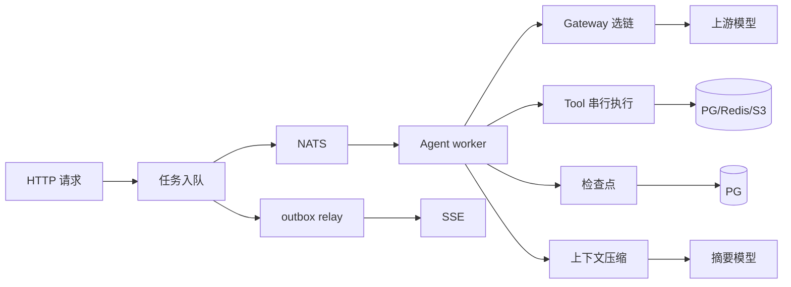

---

## 13. 扩展点/插件机制

### 扩展点清单

#### 插件系统

本项目没有运行时可加载插件（无 Go plugin/动态库）；扩展通过**接口实现 + 注册表 + 配置**完成。

#### Hook 机制

| Hook 点 | 触发时机 | 参数 | 返回值影响 |
|---|---|---|---|
| `agent.PrepareHook` | 每次调模型前 | messages, step, remaining | 替换消息序列；失败则用原消息 |
| `agent.RunHooks.OnProgress` | 每步/每工具批次后 | cost, toolCalls | 更新运行预算 |
| `agent.RunHooks.StopReason` | 每步开始 | — | 非空则停止 |
| `tool.SpillStore` | 大结果落盘 | name/data/contentType | 返回 URI |
| `workflow.NodeRunner` | 节点执行 | NodeRequest | NodeResult |
| `event.Emitter` | 各模块发事件 | Event | 无（观测） |

#### 回调机制

| 回调点 | 注册方式 | 触发条件 |
|---|---|---|
| `gateway.Factory` | `RegistryOptions.Factory` | 创建 provider 时 |
| `context.Summarizer` | 构造 `Compactor` | L2/L3 压缩 |
| `memory.LLM` | 构造 Manager | 提取/判定/关系 |
| `memory.Embedder` | 构造 Manager | 召回/写入 |
| `strategy.EvalStore` | 构造 Selector | 评测选择 |
| `agent.ChatClient/ToolInvoker/ContextBuilder` | 构造 Runtime | 运行时依赖注入 |

#### 中间件

| 中间件位置 | 职责 | 执行顺序 |
|---|---|---|
| chi `RealIP/Recoverer/Timeout` | 真实 IP、panic 恢复、60s 超时 | 控制面请求 |
| gRPC unary interceptor | panic 恢复、trace 注入 | 所有 unary RPC |
| gRPC stream interceptor | panic 恢复 | 所有 stream RPC |
| `event.Safe` | 吞掉 emitter panic | 所有事件出口 |
| `event.Persistent/Multi` | 批量落库/多路分发 | 事件出口 |

#### 注册表

| 注册表 | 管理对象 | 注册方式 |
|---|---|---|
| `gateway.Registry` | 模型、alias、provider | 配置文件 |
| `tool.Registry` | 工具实例 | 代码注册（builtin） |
| `agent.StageRegistry` | 阶段定义 | 内置 + 配置覆盖 |
| `strategy.Registry` | 组件策略元数据 | 代码注册 + 配置模板 |
| `workflow.Pool` | Agent 能力元数据 | 代码注册（7 阶段） |

#### 适配器

| 适配器 | 抽象接口 | 具体实现 |
|---|---|---|
| provider | `provider.Provider` | openai/dashscope/vllm/mock |
| 存储 | `tool.ExecutionRepo`、`memory.Store` 等 | postgres / memstore |
| 事件 | `event.Emitter` | InMemory / Persistent / NATS / Multi |
| 传输 | gRPC clients | `internal/transport/clients.go` |
| 工作流节点 | `workflow.NodeRunner` | 本地 Runtime / 远程 AgentClient |

#### 策略模式

| 策略点 | 接口/实现 | 实现类 |
|---|---|---|
| 模型选链 | `gateway.Select` + 配置 strategy | capability/priority/weight/cost/health |
| 上下文 | `context.Manager` 内 switch | linear/tiered |
| 组件策略 | `strategy.Selector` | template/rules/evaluated/default |
| 多 Agent | `multiagent.Orchestrator` switch | parallel/committee/debate/hierarchical |
| 经验恢复 | `experience.Decide` | retry/wait_recheck/adjust/rollback/skip/request_auth/abort |

### 扩展指南

#### 新增功能接入方式

| 想扩展 | 接入点 | 步骤 |
|---|---|---|
| 新厂商 | `internal/provider/<name>` + `gateway.DefaultFactory` | 实现 Provider/ChatModel/EmbeddingModel；配置 `models.*.provider` |
| 新工具 | `internal/tool/builtin` + `composition.BuildTools` | 实现 `tool.Tool`；配置 `tool.enabled`/权限 |
| 新阶段 | `agent.BuildStages` + 配置 `agent.stages.*` | 加 prompt/keywords/tools；无需改 runtime |
| 新上下文策略 | `context.Manager.Build` 的 switch | 加策略函数；配置 `context.strategy` |
| 新组件策略 | `composition.RegisterBuiltinStrategies` | 注册六要素；模板/契约 |
| 新工作流节点 | `composition.BuildWorkflow` + Pool | 注册 AgentSpec + NodeRunner |
| 新存储 | 实现领域包接口（Store/Repo） | 在 `composition.Open` 注入 |
| 新服务角色 | `app.runServe` + `service/*d` | 加 proto/service/角色分发 |

### 扩展点稳定性评估

| 扩展点 | API 稳定性 | 文档完善度 | 测试覆盖 |
|---|---|---|---|
| Provider 接口 | 高（窄接口） | 中 | 无 |
| Tool 接口 | 高 | 中 | 有（核心） |
| Stage 配置 | 高（数据驱动） | 中 | 有（路由） |
| 策略注册/契约 | 中（六要素强制） | 高（docs/innovations） | 有（部分） |
| 工作流 Pool/NodeRunner | 中 | 高 | 有（引擎） |
| 存储接口 | 中（宽接口） | 中 | 部分（内存） |
| proto 契约 | 中 | 中 | 无 |

### 扩展限制

| 位置 | 限制描述 | 改进建议 |
|---|---|---|
| `agent.StageOrder` + `composition.BuildWorkflow` | 工作流 Pool 固定注册 7 个内置阶段；自定义阶段不能自动成为图节点 | 从 StageRegistry 动态构建 Pool |
| `context.Manager.Build` | 策略是 `linear/tiered` 的硬编码 switch；新增策略需改代码 | 引入 `ContextStrategy` 接口注册表 |
| `agent/router.go` | 规则打分/关键词是启发式；LLM 路由有但默认关闭 | 可接受；如需更强语义路由，接入 embedding/分类器 |
| `workflow/engine.go` | 无跨副本资源租约；`resource_leases` 表未使用 | 接入租约表或限制单副本 |
| `provider/compat.go` | 只覆盖 OpenAI 兼容协议；非兼容厂商需新适配器 | 已有适配器扩展点，成本可控 |
| `service/controld` | 无鉴权、无租户隔离（只透传 tenant_id） | 接入网关鉴权/多租户中间件 |
| `internal/skill` | 未实现 | 按原设计加 Skill 表 + 加载/执行 |

### 平台化程度评估

**结论：介于“可配置平台”和“固定流程程序”之间，偏平台化。**

- **平台化证据**：模型/工具/阶段/策略/工作流节点都通过注册表或配置扩展；服务角色可独立部署；存储/事件/传输有接口；新增厂商/工具/阶段通常不改核心循环。
- **固定流程证据**：七阶段顺序、上下文两种策略、工作流 Pool 固定七阶段、Agent 循环结构固定；没有运行时插件加载/热更新；策略层只选择不实现。

---

## 14. 抽象架构

### 架构模式

#### 主要模式

**微服务 + 分层架构 + 事件驱动 + Agent Loop + DAG 调度**的混合体。

#### 模式证据

| 证据 | 说明 |
|---|---|
| `internal/service/*d` + `api/proto/v1` | 按角色拆分的 gRPC 服务 |
| `internal/composition` | 分层组合根；provider ← gateway ← agent |
| `internal/event/nats.go` + `event/persistent.go` | 作业/事件的异步总线与 outbox |
| `internal/agent/executor.go` | “想 → 调工具 → 再想”的 Agent Loop |
| `internal/workflow/engine.go` | DAG 拓扑调度与节点状态机 |
| `internal/strategy` | 组件策略选择层 |
| `internal/experience` | 失败反馈闭环 |

#### 辅助模式

- **Repository**：`store/postgres` 实现领域仓储接口。
- **Adapter**：provider 适配厂商；transport 适配 gRPC。
- **Registry**：模型/工具/阶段/策略/Agent Pool。
- **Pipeline**：上下文构建 → 压缩 → 组装；数据流分析。
- **State Machine**：Agent 运行、工具执行、工作流节点、经验状态。

### 控制流与数据流

#### 控制流主导方式

- **同步**：控制面 → gRPC → gateway/tool/memory/strategy/experience；orchestrator → agent。
- **异步**：控制面 → NATS `agent.run`/`workflow.run` → worker；事件 outbox → NATS → SSE。
- **循环**：Agent executor 的 for 循环；workflow scheduler 的就绪批处理循环。
- **回调/钩子**：prepare/progress/stop；NodeRunner；Emitter。

#### 数据流主导方式

- **权威状态**：Postgres（会话、运行、检查点、工具执行、事件、记忆、经验、工作流、任务）。
- **快路径**：Redis（幂等 claim/done、限流、取消、锁）。
- **大对象**：S3/MinIO（工具结果、产物）。
- **消息**：NATS（作业、事件）。
- **进程内**：预算、熔断、限流、缓存、调用栈。

### 设计取舍

#### 核心取舍

| 取舍点 | 选择 | 放弃 | 原因 |
|---|---|---|---|
| 部署形态 | 单二进制多角色 | 每服务独立二进制 | 统一镜像/构建；仍可按角色扩缩容 |
| 内部通信 | gRPC + protobuf | REST/JSON | 强类型、流式、性能 |
| 异步 | NATS JetStream | Kafka/RabbitMQ | 轻量、Go 原生、durable + 队列 |
| 权威存储 | Postgres + pgvector | 专用向量库 | 少一个基础设施；维度受限（768/1024） |
| 幂等 | PG 唯一约束 + Redis 快路径 | 纯 Redis | 清 Redis 不会让去重失效 |
| 上下文压缩 | 进程内库 + 摘要走 gateway | 独立上下文服务 | 低延迟、可测；跨副本缓存不共享 |
| 策略层 | 只选择不实现 | 策略层构造组件 | 避免第二个工厂；策略实现归各自模块 |
| 工作流调度 | 单调度器 + 波次并行 | 完全事件驱动 | 实现简单；并行效率有代价 |
| 安全 | 内网明文 gRPC + 工具权限 | mTLS/鉴权（未实现） | 一期范围；生产需补 |

#### 架构优势

1. **失败语义清晰**：不可用/降级/不确定/拒绝/预算耗尽都能区分。
2. **可恢复**：检查点 + 幂等 + `needs_review`，长任务可续跑。
3. **可审计**：事件、用量、工具执行、检查点都有权威记录。
4. **可扩展**：厂商/工具/阶段/策略/节点都有注册或接口。
5. **默认可跑**：mock + 无依赖模式降低上手成本。
6. **服务边界合理**：模型、工具、记忆、编排各自独立扩缩容。

#### 架构劣势

1. **基础设施多**：Postgres + Redis + NATS + S3，运维成本高。
2. **分布式一致性复杂**：outbox、幂等、租约、预算跨进程都需要额外设计。
3. **测试缺口**：最复杂的分布式链路没有集成测试。
4. **单文件偏大**：`controld` 762 行、`app` 1,262 行，后续维护成本上升。
5. **工作流并行效率**：波次屏障限制 DAG 调度。
6. **安全边界不足**：无鉴权/mTLS；bash soft sandbox。
7. **可观测性**：有 trace_id 与事件，但未接 OpenTelemetry/Prometheus。

### 架构图

#### 概览图

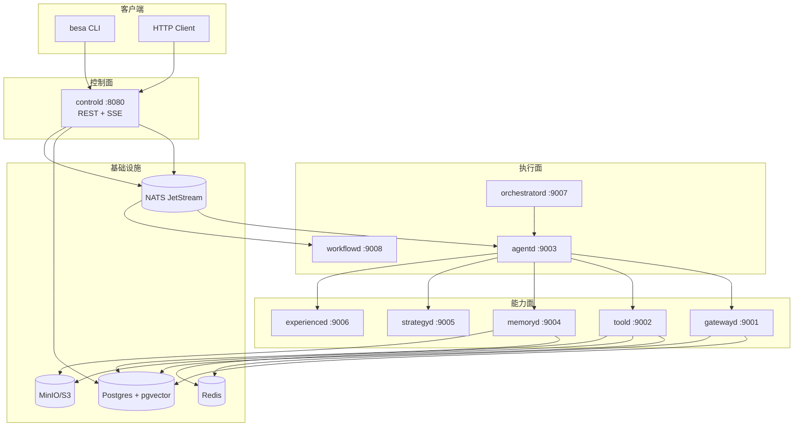

#### 分层图

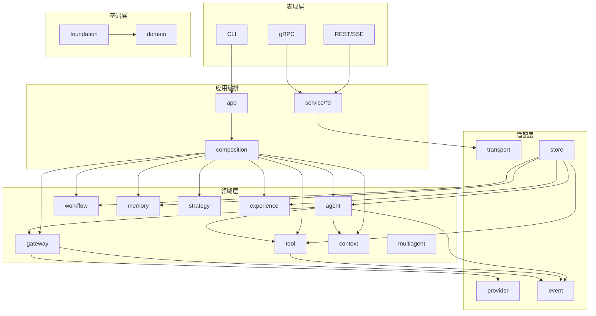

### 架构演进建议

1. **补集成测试**（P0）：Testcontainers/Compose 起 PG/Redis/NATS，跑迁移 + 提交任务 + 工具幂等 + 续跑 + SSE。
2. **补 CI**（P0）：`go vet`、`go test`、`go build`、迁移测试；当前无 `.github/workflows`。
3. **工作流调度事件化**（P1）：节点完成即调度，去掉波次屏障；加跨副本资源租约。
4. **控制面拆分**（P1）：`controld` 拆 HTTP handler / SSE hub / outbox relay / task store。
5. **安全**（P1）：mTLS、REST 鉴权、租户隔离；bash 容器化。
6. **可观测性**（P2）：OpenTelemetry trace/metrics、Prometheus、结构化事件指标。
7. **预算持久化**（P2）：failover 后从 usage/run_steps 重建预算。
8. **清理脚手架**（P2）：空目录 `agent/stages`、`foundation/telemetry`；未使用字段/变量。

---

## 15. 面试讲解版

### 1 分钟版 - 项目目标

> BesaAgent 是一个面向软件测试全流程的多智能体平台，覆盖需求、测试设计、用例、环境、执行、分析和缺陷七个阶段。Go 版把模型网关、工具执行、Agent 运行时、记忆、策略、工作流和经验闭环拆成可独立部署的服务；核心目标不是“生成文本”，而是让长任务在失败、打断、重复提交时仍然**可判定、可恢复、可审计**。

### 3 分钟版 - 整体架构

#### 技术选型

- Go 1.26：单二进制多角色、低运行时开销、并发模型适合大量 IO。
- gRPC + protobuf：内部服务强类型、支持流式；REST/SSE 面向外部。
- NATS JetStream：作业队列（durable consumer、ack/nak、msg-id 去重）与事件总线。
- Postgres + pgvector：权威状态 + 向量检索，少一个专用向量库。
- Redis：幂等快路径、分布式限流、取消信号、锁。
- MinIO/S3：工具大结果与产物，避免本地路径跨节点失效。

#### 架构设计

控制面/执行面/能力面分离：

- 控制面 `controld` 接收任务、查询状态、SSE；任务落库后投递 NATS。
- `agentd` 消费任务，跑 Agent 循环；调用 `gatewayd` 选模型、`toold` 执行工具、`memoryd` 召回/沉淀。
- `orchestratord`/`workflowd` 负责多 Agent 与 DAG 调度，节点通过 gRPC 调 `agentd`。
- `strategyd` 只做组件策略选择；`experienced` 做失败分类与经验检索。
- 状态分层：Postgres 权威、Redis 快路径、S3 大对象、NATS 消息。

#### 模块划分

`provider → gateway → agent` 是核心依赖链；`context` 决定看什么；`tool` 管副作用；`workflow`/`multiagent` 管编排；`memory`/`strategy`/`experience` 分别管长期记忆、策略选择、经验闭环；`composition` 是唯一装配点。

### 3 分钟版 - 核心调用链

```
HTTP POST /v1/tasks
 → controld 校验 + 建任务 + 投递 NATS
 → agentd 消费：加载历史 → Runtime.RunOne
 → 路由阶段 → 续跑判定 → context 构建/压缩
 → AgentExecutor 循环：
     gateway.Chat（选链/熔断/限流/重试/降级/计价）
     → 有 tool_calls：toold.Invoke（schema/注入/权限/幂等/执行/脱敏）
     → 回填结果 → 写检查点
 → 最终答案 → 写消息/任务状态/事件
 → outbox relay → NATS → SSE 推送
```

### 2 分钟版 - 亮点与难点

#### 技术亮点

1. **单一策略链**：gateway 把选链、熔断、限流、重试、降级、计价收在一个方法里，顺序是约束；`CallBudget` 是唯一计数点，避免重试风暴。
2. **工具幂等两阶段**：Redis 快路径 + PG 唯一约束；读取时把超租约 `in_flight` 判为 `uncertain`，续跑默认 `needs_review`，不替人做“重做/放弃”的取舍。
3. **运行内按步压缩**：一次运行内部消息全在同一轮，按轮切压不掉；按“步”切并保证工具配对不被切断，L1 先做零成本截断，再 L2/L3 摘要。
4. **策略层只选择不实现**：组件策略注册 + 五条契约 + 模板/规则/评测；高风险任务只在“合法 ∩ 已验证”组合里选，空集拒绝而不降级。
5. **DAG fail-closed**：依赖闭合/无环/IO/权限/资源五类校验，任一失败一个节点都不跑。

#### 技术难点

1. **跨进程续跑一致性**：工具副作用发生在文件/子进程/外部 API，无法和检查点同事务。解决：检查点只负责“从哪接着跑”，幂等层负责“不重复做”；用 `uncertain` 显式表达“不知道”。
2. **重试层次**：provider 和 gateway 都重试会相乘。解决：provider 只重试网络层，HTTP 错误交 gateway 跨模型决策，`CallBudget` 封顶。
3. **上下文窗口**：工具结果大、步骤多。解决：按步切分 + L1/L2/L3 + 预算分配 + 整块裁剪 + 明确降级。
4. **多副本一致性**：事件 outbox、幂等唯一约束、NATS durable consumer、Redis Lua。

### 1 分钟版 - 不足与改进

> 最大不足是**测试与验证**：41 个单元测试覆盖了核心算法，但没有任何集成/E2E 测试，Postgres 迁移、NATS 消费、工具幂等跨进程、SSE 都没有自动化验证；也没有 CI。其次是工作流调度有波次屏障、跨副本资源租约未落地、控制面无鉴权、gRPC 内网明文、bash 仍是 soft sandbox。下一步优先补 Testcontainers/Compose 集成测试和 CI，再做事件驱动调度与安全加固。

### 面试要点备忘

| 问题 | 回答要点 |
|---|---|
| 为什么拆服务？ | 模型调用、工具副作用、记忆、编排的扩缩容与故障隔离需求不同；同步用 gRPC，异步用 NATS |
| 为什么不用纯 Redis 做幂等？ | 清库会让去重静默失效；PG 唯一约束是权威，Redis 只是快路径 |
| `None`/nil 与 0 的区别？ | 0 是免费，nil 是未知；混同会让成本报表静默失真 |
| 重试为什么不放在 provider？ | 厂商故障需要跨模型决策；两层重试相乘会形成重试风暴 |
| 续跑如何避免重复副作用？ | 检查点 + 幂等键 + `uncertain` 判定；默认 `needs_review` |
| 工作流如何保证不跑错图？ | Validator 五类检查 fail-closed，auto 图默认不放行 |
| 多 Agent 如何避免把逻辑下沉？ | 单 agent `run_one` 自足；编排只调用它，不修改它 |
| 最大风险？ | 分布式链路缺少集成测试；PG 迁移未在真实环境执行 |
| 如何扩展新模型/工具/阶段？ | provider/tool/stage/strategy/workflow Pool 的注册点；配置驱动 |
| 为什么事件表兼 outbox？ | 与业务写入同库，至少一次发布；relay 用 `FOR UPDATE SKIP LOCKED` |

---

## 总体结论

### 优势

1. **架构意图与代码一致**：文档里的关键纪律能在代码中找到对应实现，不是“文档驱动”的空壳。
2. **失败语义成熟**：不可用、降级、不确定、拒绝、预算耗尽、需要人看，全部有独立状态与事件。
3. **扩展点清晰**：厂商/工具/阶段/策略/工作流节点/存储/事件都有接口或注册表。
4. **默认可运行**：mock 模式无需外部依赖；Build/Vet/Test 均通过。
5. **持久化模型完整**：22 张表覆盖会话、运行、检查点、工具、事件、记忆、经验、工作流、评测。

### 主要风险

1. **集成测试为零**：分布式是本项目最大复杂度，却没有自动化验证。
2. **迁移未实测**：SQL/JSONB/pgvector 只经过审查；目标库无 `CREATEDB` 权限，未执行。
3. **无 CI**：没有 `.github/workflows`，回归依赖手工。
4. **工作流调度效率与跨副本资源租约**。
5. **安全边界**：无鉴权/mTLS；bash soft sandbox。
6. **可观测性**：有 trace_id/事件，未接 OTel/Prometheus。

### 建议优先级

| 优先级 | 建议 | 理由 |
|---|---|---|
| P0 | Testcontainers/Compose 集成测试（PG/Redis/NATS + 迁移 + 任务链路） | 覆盖最大风险面 |
| P0 | CI：vet/test/build/migrate | 防止回归 |
| P1 | 工作流事件驱动调度 + 跨副本资源租约 | 提升并行与正确性 |
| P1 | 控制面鉴权/mTLS；bash 容器化 | 生产安全 |
| P1 | 工具批量并发（保持配对顺序） | 降低多工具批次延迟 |
| P2 | 记忆 embedding 复用/批量化 | 降低记忆写入成本 |
| P2 | 预算持久化、OTel、策略评测 worker、Skill/MCP | 完善平台能力 |
| P2 | 拆分 `controld`；清理空目录/死代码 | 可维护性 |

---

## 证据清单

| 结论 | 证据位置 | 影响评估 |
|---|---|---|
| 单二进制多角色入口 | `cmd/besa/main.go:12`，`internal/app/serve.go:62` | 部署形态的核心 |
| 8 个 gRPC 角色 | `api/proto/v1/besa.proto`，`internal/service/*d` | 服务边界 |
| 控制面 REST/SSE | `internal/service/controld/server.go:71/122/287` | 外部接口 |
| NATS 作业/事件 | `internal/event/nats.go` | 异步与解耦 |
| Postgres 22 张表 | `migrations/0001_init.sql` | 权威状态 |
| Redis 幂等/限流/取消 | `internal/store/redis/redis.go:74/141/194` | 快路径与一致性 |
| 网关策略链 | `internal/gateway/gateway.go:125/357`，`router.go:12` | 核心调用路径 |
| 工具顺序与幂等 | `internal/tool/executor.go:62`，`idempotency.go:145` | 副作用正确性 |
| Agent 续跑 | `internal/agent/runtime.go:124/286` | 长任务可恢复 |
| 按步压缩 | `internal/context/compact.go:51`，`runtime.go:241` | 上下文窗口 |
| 工作流 fail-closed | `internal/workflow/validate.go:18`，`engine.go:58` | 编排正确性 |
| 策略契约/高风险拒绝 | `internal/strategy/selector.go:56`，`contracts.go` | 策略安全 |
| 经验门控 | `internal/experience/manager.go:67` | 未验证不入库 |
| 41 个单元测试 | 9 个 `*_test.go` | 核心算法覆盖 |
| 无集成测试/CI | 仓库无 `integration` 目录、无 `.github/workflows` | 最大风险 |
| 空脚手架 | `internal/agent/stages`、`internal/foundation/telemetry` | 代码整洁度 |
| 无导入环 | 脚本扫描 127 个非测试文件 | 依赖健康 |

---

## 待确认项

1. **Postgres 迁移未在真实库执行**：本机 `besa` 用户无 `CREATEDB` 权限，未创建临时库；SQL 语法、JSONB 绑定、pgvector 索引、HNSW 参数均未运行时验证。
2. **Docker Compose / K8s 未实机启动**：本机无 Docker；8 服务、NATS durable、SSE、MinIO 的联动未验证。
3. **真实厂商未调用**：OpenAI/DashScope/vLLM 适配器只经过代码审查；SSE 解析、tool_calls、reasoning、usage 未实测。
4. **覆盖率只测到一部分**：`go test -cover ./internal/...` 仅成功返回 strategy 41.1%、tool 52.4%、workflow 53.1%；其余包因 `go1.26.0` 编译产物与 `go1.25.1` 工具版本不一致而失败，未得到完整覆盖率。
5. **性能未压测**：TOP 3 瓶颈基于代码结构推断，无实际延迟/吞吐数据。
6. **工作流多副本资源语义**：`resource_leases` 表已建但未使用；多 `orchestratord` 副本的行为未验证。
7. **安全评估有限**：未做渗透/依赖漏洞扫描；REST 无鉴权、gRPC 明文是代码事实，但是否可接受取决于部署边界。
8. **K8s 清单未 apply**：`deploy/k8s/besa.yaml` 的 Service DNS、探针、资源限制未运行验证。
9. **仓库名拼写**：远端为 `BesaAgeny-Go`（用户给定），与项目名 `BesaAgent` 不一致；是否改名需用户确认。
10. **空目录/死代码**：`internal/agent/stages`、`internal/foundation/telemetry` 为空；`controld.handleRunSync` 有未使用的 `err` 变量；`provider.CompatProvider.defaults` 字段未被使用。是否清理需确认。
