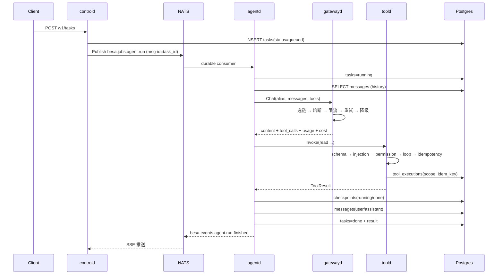

# 分布式架构设计

本文说明 Go 版如何把原 Python 单进程运行时拆成可独立部署的服务，以及拆分后**哪些语义必须保持不变**。

## 1. 目标与非目标

**目标**

- 保留原 `docs/` 中的分层与契约：provider / gateway / agent / context / tool / memory / strategy / workflow / experience。
- 让长任务、工具副作用、模型调用、记忆检索各自可以独立扩缩容与故障隔离。
- 把「跑到一半被打断」做成可判定状态（检查点 + `needs_review`），跨进程仍成立。
- 所有跨进程状态可追溯：事件、用量、工具执行、检查点都有权威记录。

**非目标**

- 不追求把每个纯函数都变成服务。路由打分、预算、压缩、DAG 校验仍是库。
- 不做语义路由与精确 tokenizer（与一期一致，字符数 / 4 估算）。
- 不为多租户做完整鉴权（预留 `tenant_id` 字段，HTTP 层可接网关鉴权）。

## 2. 依赖方向

```
foundation  ←  domain  ←  provider  ←  gateway  ←  agent / context / tool / memory / strategy / workflow / experience
                                                   ↑
                                              service/*d
                                                   ↑
                                              composition  →（唯一的装配点，无人反向依赖）
                                                   ↑
                                                 app / cmd
```

机器可查的约束：

- `internal/foundation` 不 import 任何业务包；
- `internal/provider/*` 不 import gateway 及以上；
- **只有 `internal/gateway` 直接使用 provider**；其他模块通过 gateway 或 transport DTO；
- `internal/agent` 不 import `internal/multiagent` / `internal/workflow`（被编排者不知道自己在被编排）；
- `internal/context` 不直接调用 memory 的三道闸门，只经 `MemoryProvider` 接口；
- `internal/composition` 是唯一把全部模块接起来的地方。

`go build ./...` 与 `go vet ./...` 是当前的门禁；如需机械校验依赖方向，可在 CI 加 `depguard` 规则。

## 3. 进程边界

| 边界 | 同步协议 | 异步通道 | 为什么在这切 |
|---|---|---|---|
| 控制面 → 执行面 | REST | NATS `agent.run` / `workflow.run` | 提交要快，执行可能几十分钟 |
| agent → gateway | gRPC `Chat/Embed/StreamChat` | — | 低延迟、强类型；模型密钥只存在于 gateway |
| agent → tool | gRPC `Invoke` | — | 工具执行必须集中做权限/幂等/审计 |
| agent → memory | gRPC `Remember/Recall` | — | 记忆跨会话共享 |
| orchestrator → agent | gRPC `RunOne` | — | 节点执行需要同步结果来推进 DAG |
| 所有服务 → 事件 | NATS `besa.events.*` | Postgres outbox | 观测不应成为主链路依赖 |

单机模式（`--role all` 或 CLI）把上述边界折叠为进程内调用，接口保持不变。

## 4. 一次任务的完整路径



### 4.1 为什么作业用 JetStream 而不是普通订阅

- durable consumer + ack：worker 崩溃后消息会重投（至少一次）；
- `msg-id = task_id`：提交侧去重；
- 同一 durable 名让多个 `agentd` 副本竞争消费，天然水平扩展；
- 任何副作用由**工具幂等**兜底，因此“至少一次”不会导致重复执行。

## 5. 状态与一致性

### 5.1 三类权威记录

| 状态 | 表 | 保证 |
|---|---|---|
| 工具是否执行过 | `tool_executions UNIQUE(scope, idem_key)` | 唯一约束是并发闸门；Redis 只是缓存 |
| 运行跑到哪一步 | `checkpoints`（append-only） | `needs_review` 必须可被 `unfinished()` 查到 |
| 事件/用量 | `events`（兼 outbox）、`usage` | 与业务写入同库；relay 至少一次发布 |

### 5.2 幂等两阶段

```
claim(scope, idem_key, owner, lease)
   ├─ done     → 直接复用结果（副作用不再发生）
   ├─ in_flight→ 拒绝并发重复
   └─ claimed  → 去权威记录确认
                  ├─ done → 回填缓存
                  ├─ in_flight/uncertain → 不执行
                  ├─ failed → reopen 后执行
                  └─ 无记录 → register 后执行
执行 → mark_done(结果) / mark_failed(错误，可重试)
```

- **Redis 不可用**：退到只用权威记录的慢路径，语义仍正确；
- **权威记录不可用**：`read` 按配置放行（`executed_degraded`），`write/destructive` 拒绝；
- **读取时判定 `uncertain`**：`state=in_flight` 且 `now-started_at > lease`；
  不写回，避免把“不知道”钉成“具体状态”。

### 5.3 检查点与续跑

`agentd` 每完成一个工具批次就写一条 `checkpoints`；终态再写一条。续跑时：

1. 最近快照是 `needs_review` → 继续 `needs_review`（先处理，再决定）；
2. 已完成（`done/failed/cancelled`）→ 当作重跑；
3. `running` → 还原 `TaskRun`，用快照里记录的 `idem_keys` 查 `tool_executions`：
   - 有 `uncertain` → 按 `agent.resume.on_uncertain`（默认 `needs_review`）；
   - 无 → 从下一步继续。

> 检查点只回答“从哪接着跑”；**不重复副作用**由幂等层保证。两者分开，才好在其中一个失效时知道自己在哪一档。

### 5.4 事件 outbox

- 服务内 `event.Persistent` 把事件批量写 `events`，`published_at IS NULL` 的行由 `controld`
  的 relay 用 `FOR UPDATE SKIP LOCKED` 取走并发布到 NATS；
- 消费方按 `event_id` 去重；
- 事件发布失败只记录，不影响主流程。

## 6. 各服务的失败语义

| 场景 | 行为 | 可见性 |
|---|---|---|
| 候选模型 503 | provider 上抛 → gateway 重试/降级 | `attempts[]` + `gateway.call.degraded` |
| 熔断打开 | 跳过候选，不消耗重试/预算 | `skipped_reason=circuit_open` |
| 限流超限 | `wait` 排队（受 deadline 约束）或 `fallback` | `gateway.quota.exhausted` |
| 所有候选失败 | `AllCandidatesFailed`，保留每次原因 | `attempts[]` |
| 流式已输出正文 | 禁止重试/降级 | `StreamCommittedError` |
| 工具参数不合法 | 拒绝，**绝不“尽力执行”** | `tool.refused` + 具体位置 |
| 权限不足 | 拒绝，且**不登记幂等** | 同上 |
| 幂等不可用 | 只读放行并标 `executed_degraded`；写拒绝 | `tool.executed_degraded` |
| 工具崩溃 | 转成失败结果回给模型，不拖垮 agent | `ToolResult.error_kind/recovery/hint` |
| 续跑遇不确定 | 默认 `needs_review` | `agent.resume.decided` |
| 上下文预算不足 | 固定段不截断，标记 degraded | `context.compact_degraded` |
| NATS/Redis 不可用 | 启动期告警；降级路径明确 | `/v1/doctor`、日志 |

## 7. 扩缩容与资源

- **agentd / workflow worker**：无状态（状态全在 Postgres），按 durable consumer 竞争消费。
- **gatewayd**：无状态；熔断表是每副本独立的（共享熔断的写竞争成本高于收益）；
  分布式限流走 Redis。
- **toold**：无状态；工具工作目录与对象存储是共享资源，需按权限范围配置。
- **controld**：无状态；多个副本共享 tasks 表与 NATS，SSE 各自订阅。
- **workflow 独占资源**：`workflow.resources.<name>.capacity` 控制同时占用数；
  跨副本的严格互斥需要把资源租约落到 Redis/Postgres（当前是单调度器内的计数）。

## 8. 安全边界

1. 模型密钥只出现在 gateway 进程环境；配置里只有变量名。
2. 工具执行在 toold 进程内重新校验 schema / 注入 / 权限；**agent 的“已授权”声明不可信**。
3. 工具环境变量白名单，默认不继承宿主环境（避免 `bash env` 打出密钥）。
4. 结果回灌前脱敏，并加“不可信内容”标记；这是缓解，不是安全边界。
5. 大结果写对象存储，`s3://` URI 不暴露本地路径；下载用短期签名 URL。
6. 内网 gRPC 目前明文；跨公网部署需加 mTLS（`transport.Dial` 是唯一改动点）。

## 9. 关键决策与代价

| 决策 | 选择 | 代价 / 缓解 |
|---|---|---|
| 单二进制多角色 | `besa serve --role` | 部署简单；镜像统一，按角色扩缩容 |
| 事件总线 | NATS JetStream | 多一个基础设施；换取 durable + 队列语义 |
| 同步内部协议 | gRPC | proto 维护成本；换取强类型与流式 |
| 幂等权威 | Postgres 唯一约束 | 每次写多一次库往返；Redis 快路径可缓解 |
| 记忆向量 | pgvector | 维度受限（768/1024）；避免再引入向量数据库 |
| 上下文压缩 | 库内完成 | 摘要调用走 gateway；缓存进程内，跨副本不共享 |
| 策略层 | 只登记/选择，不实现策略 | 策略实现仍在各自模块，工厂在组合根 |

## 10. 已知差距 / 下一阶段

- **策略评测 worker**：`strategy_eval` 表与选择器已就绪，离线评测任务尚未实现。
- **经验验证器**：分类/恢复/门控/检索已实现；需求、用例、环境等专用验证器仍是规则骨架。
- **工作流跨副本资源租约**：目前是单调度器计数；多调度器需要租约表。
- **会话摘要链**：tiered 策略的摘要目前随请求组装，未单独持久化。
- **OpenTelemetry**：已保留 trace_id 贯穿，尚未接入 OTLP exporter。
- **MCP / OpenAI 兼容对外接口**：REST 已具备，MCP server 未实现。
